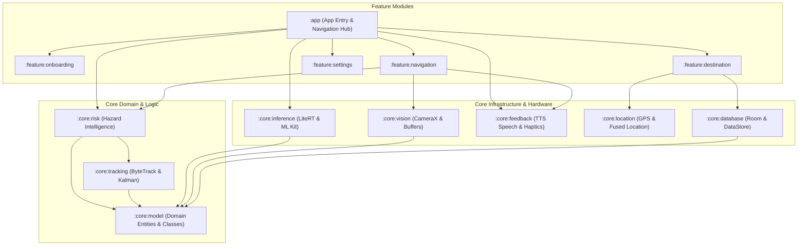
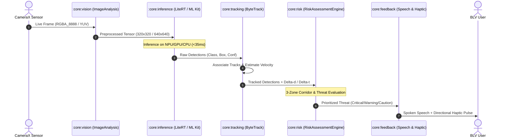

# Technical Architecture Document
## DRISHTI: AI-Powered Offline Mobility Assistant

**Document Version:** 1.0.0  
**Target Platform:** Android 10.0+ (API Level 29 Minimum, API Level 34 Target)  
**Architecture Pattern:** Clean Architecture + Modular MVVM / Unidirectional Data Flow (MVI)  
**Core Language:** Kotlin 1.9.24 / 2.0+ with Kotlin Coroutines & Flows

---

## 1. Architectural Overview & System Modules

Drishti follows a modular Clean Architecture structure with decoupled layers:
1. **Presentation Layer (`:app`, `:feature:*`):** Jetpack Compose UI, Material 3, ViewModels, Accessibility Semantics, and Navigation.
2. **Domain Layer (`:core:model`, `:core:risk`, `:core:tracking`):** Pure Kotlin business logic, spatial hazard algorithms, tracking Kalman filters, and threat level matrices.
3. **Data / Infrastructure Layer (`:core:vision`, `:core:inference`, `:core:feedback`, `:core:location`, `:core:database`):** CameraX pipeline, LiteRT tensor runtime, ML Kit fallback, Android TTS, VibratorManager, Fused Location Provider, Room DB, and DataStore preferences.

---

## 2. End-to-End Real-Time Perception Pipeline

The vision pipeline is strictly non-blocking. Video frames from CameraX are analyzed using `STRATEGY_KEEP_ONLY_LATEST` to avoid lag accumulation. Outdated frames are immediately dropped.

---

## 3. Module Responsibilities & Package Boundaries

### 3.1 `:app`
- Application entry point (`DrishtiApplication`).
- Master navigation graph (`AppNavGraph.kt`) coordinating all 12 application screens.
- Global theme definitions (`Theme.kt`, `Color.kt`) supporting High-Contrast Yellow/Black accessibility styling.
- Dependency wiring and runtime permission coordinator.

### 3.2 `:core:model`
- Ground-truth domain data models:
  - `AssistiveClass`: 24-class taxonomy covering ground hazards, head-height obstacles, dynamic vehicles, and static street furniture.
  - `BoundingBox`: Normalized screen coordinates `[left, top, right, bottom]`.
  - `DetectedObstacle`: Instantaneous frame detection with confidence and timestamp.
  - `TrackedObstacle`: Object with persistent track ID, estimated ground distance, azimuth angle, clock position (1–12), approaching speed, time-to-collision, and threat level.
  - `ThreatLevel`: 4-tier risk levels (`CLEAR`, `CAUTION`, `WARNING`, `CRITICAL`) with priority weights.
  - `Waypoint` & `PedestrianRoute`: Geo-coordinates, route steps, and breadcrumbs.

### 3.3 `:core:vision`
- CameraX lifecycle binding and camera configuration (`1280x720` preview resolution).
- Zero-copy hardware buffer extraction and RGBA conversion.
- Ambient illumination and low-light detection for automated torch guidance.

### 3.4 `:core:inference`
- `ObstacleDetector` interface.
- `LiteRTDetector`: Google LiteRT runtime managing `.tflite` model inference with hardware delegates (NPU -> GPU -> CPU XNNPACK).
- Pre-processing: Bilinear scaling, normalization, coordinate scaling.
- Post-processing: Non-Maximum Suppression (NMS), confidence threshold filtering, bounding box scaling.
- Fallback integration: Google ML Kit Object Detection and Image Labeling for zero-asset on-device inference.

### 3.5 `:core:tracking`
- Multi-object tracking engine (ByteTrack algorithm).
- Kalman filter for state estimation `[x, y, aspect_ratio, height, vx, vy, va, vh]`.
- Two-stage association: High-confidence matching followed by low-confidence recovery to prevent track flickering.
- Velocity and approaching speed calculation ($v = \frac{\Delta d}{\Delta t}$).

### 3.6 `:core:risk`
- `RiskAssessmentEngine`: Central safety decision engine.
- 3-Zone lateral classification: **LEFT** (0–33%), **CENTER** (33–66%), **RIGHT** (66–100%).
- Walking corridor calculation based on ground-plane pinhole camera geometry:
  $$d = \frac{h_{\text{camera}}}{\tan(\theta_{\text{pitch}} + \alpha_{\text{pixel}})}$$
- Proximity threat calculation: Immediate collision threshold (< 1.5 m / ~2 feet).
- Cooldown and repetition suppression (4.0 s window for unchanged threat levels).

### 3.7 `:core:feedback`
- `SpeechManager`: Offline Android `TextToSpeech` with bilingual support (Hindi `hi_IN` and English `en_US`).
- Safety audio preemption: Immediate `QUEUE_FLUSH` for `CRITICAL` stops; `QUEUE_ADD` for routine guidance.
- Audio ducking: Requests transient audio focus with ducking on Android `AudioManager`.
- `HapticManager`: Spatial vibration waveforms using Android 12+ `VibratorManager` and `VibrationEffect.Composition`:
  - Critical Stop: 3 sharp max-intensity pulses (`[120ms ON, 60ms OFF, 120ms ON, 60ms OFF, 250ms ON]`).
  - Turn Left / Right: Asymmetric directional vibrations.
  - Ground Drop-off: Distinct slide-down vibration frequency.

### 3.8 `:core:location`
- Android FusedLocationProvider integration.
- Continuous location streaming with battery-aware interval adjustments (High accuracy for walking navigation, balanced power for passive safety).
- Route deviation detector: Computes cross-track error to active polyline.

### 3.9 `:core:database`
- Room Database for offline storage:
  - `waypoints`: Saved places (Home, Office, Clinic, Store).
  - `emergency_contacts`: Family contacts for SOS and location sharing.
  - `hazard_logs`: Safety incident logs and offline telemetry.
- Preferences DataStore for user settings (language, speech rate, sensitivity, haptic toggle).

---

## 4. Threading & Concurrency Architecture

| Execution Domain | Coroutine Dispatcher | Thread Affinity | Primary Workload |
| :--- | :--- | :--- | :--- |
| **Camera Capture** | `Executors.newSingleThreadExecutor()` | Background Dedicated | CameraX ImageAnalysis stream |
| **Model Inference** | `Dispatchers.Default` | Multi-core Thread Pool | LiteRT Tensor math & NPU delegate invocation |
| **Risk & Tracking** | `Dispatchers.Default` | Multi-core Thread Pool | Kalman state updates, corridor collision checks |
| **Audio & Haptics** | `Dispatchers.Main.immediate` | Main / UI Thread | TTS dispatch, VibrationEffect invocation |
| **Database & GPS** | `Dispatchers.IO` | IO Thread Pool | Room queries, DataStore write, Location callbacks |
| **Compose UI** | `Dispatchers.Main` | Main Thread | Screen composition, canvas bounding box draw |

---

## 5. Security, Permissions, and Privacy

1. **Camera Permission (`android.permission.CAMERA`):** Live preview strictly processed in volatile RAM. No image saving to public storage.
2. **Location Permissions (`ACCESS_FINE_LOCATION`, `ACCESS_COARSE_LOCATION`):** Required for turn-by-turn guidance, breadcrumbs, and emergency SOS.
3. **Foreground Services (`FOREGROUND_SERVICE`, `FOREGROUND_SERVICE_CAMERA`, `FOREGROUND_SERVICE_LOCATION`):** Ensures walking guidance remains alive when screen is locked or dimmed to preserve battery.
4. **SMS Permission (`SEND_SMS` / Intent Fallback):** For family location sharing and SOS. Implements safe `Intent.ACTION_SENDTO` fallback when direct SMS permission is restricted.

