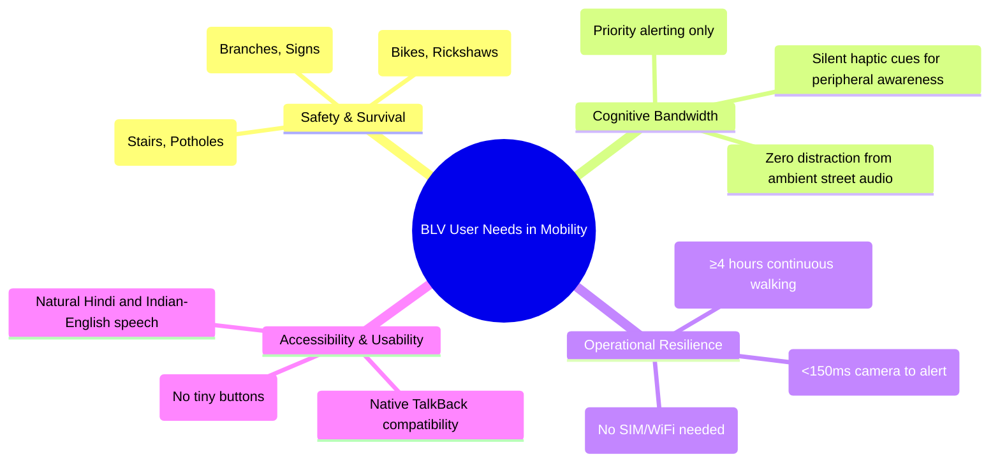
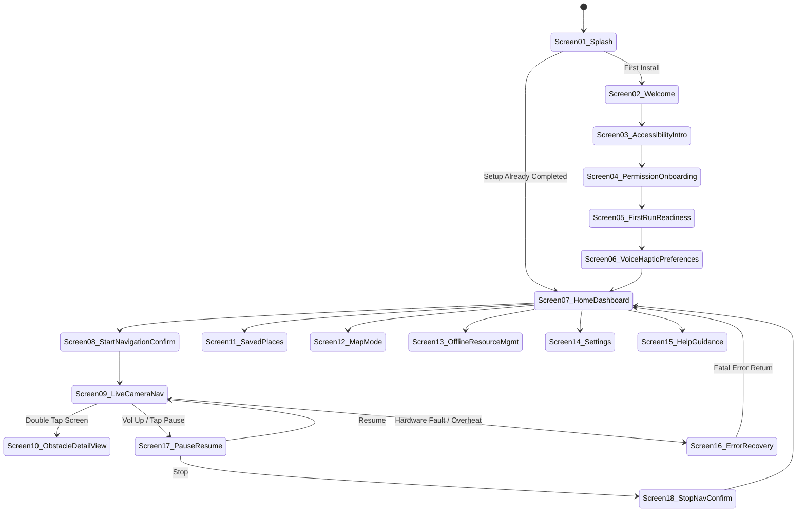
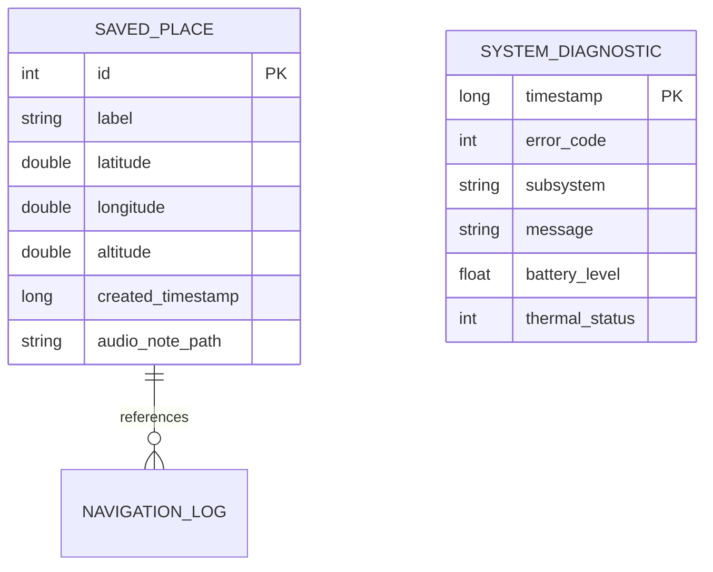
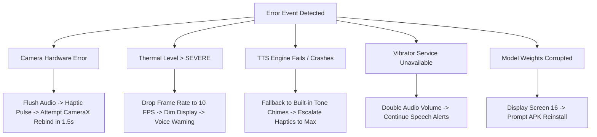
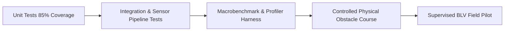
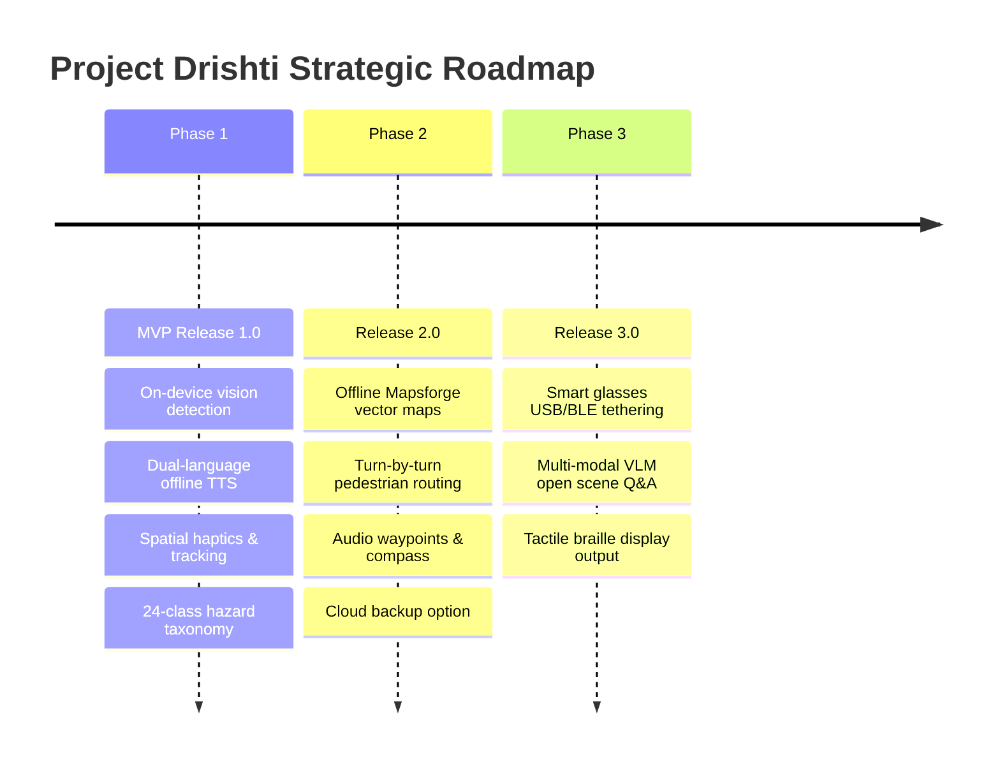
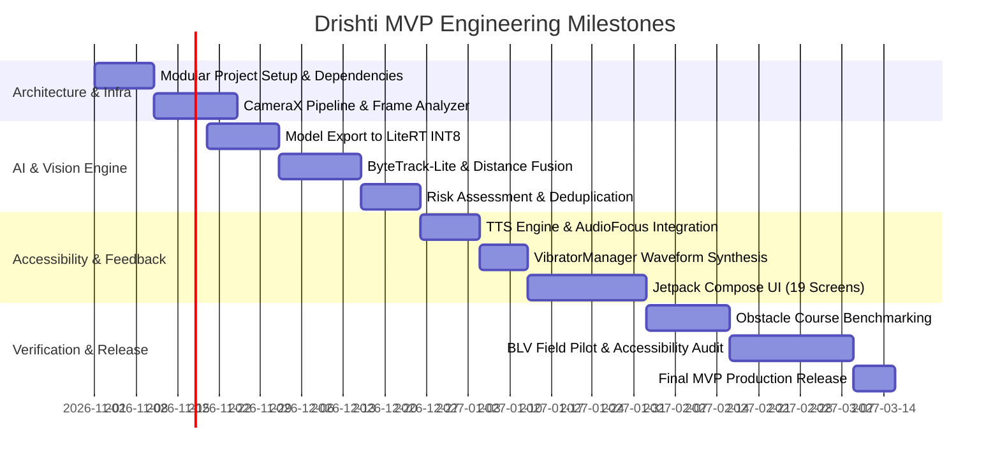

# Product Requirements Document (PRD)
## Project Drishti: Offline-First AI Mobility Assistance for People Who Are Blind or Have Low Vision

**Document Version:** 1.0.0  
**Status:** Approved for Implementation Planning (Baseline)  
**Date:** October 2026  
**Product Category:** Assistive Technology / Native Android Accessibility Application  
**Primary Platform:** Android 10.0+ (API Level 29 Minimum, API Level 34 Target)  
**Document Owner:** Senior Product Manager, Principal Android Architect, Lead AI/ML Engineer, Accessibility Specialist  
**Proposed Tagline:** *"See Beyond With Confidence."*

---

## Table of Contents
1. [Document Overview & Control](#1-document-overview--control)
2. [Executive Summary](#2-executive-summary)
3. [Product Vision and Problem Statement](#3-product-vision-and-problem-statement)
4. [Target Users and User Personas](#4-target-users-and-user-personas)
5. [User Needs and Pain Points](#5-user-needs-and-pain-points)
6. [Product Goals and Non-Goals](#6-product-goals-and-non-goals)
7. [Proposed Solution and Value Proposition](#7-proposed-solution-and-value-proposition)
8. [Functional Requirements (FR)](#8-functional-requirements-fr)
9. [Non-Functional Requirements (NFR)](#9-non-functional-requirements-nfr)
10. [Complete Screen Inventory & User Journeys](#10-complete-screen-inventory--user-journeys)
11. [Offline Versus Online Feature Matrix](#11-offline-versus-online-feature-matrix)
12. [Technical Architecture and Component Responsibilities](#12-technical-architecture-and-component-responsibilities)
13. [Technology-Stack Comparison and Final Recommendations](#13-technology-stack-comparison-and-final-recommendations)
14. [AI/ML Strategy and Model Evaluation](#14-aiml-strategy-and-model-evaluation)
15. [Camera-to-Alert Data Flow & Timing Budget](#15-camera-to-alert-data-flow--timing-budget)
16. [Local Data and Privacy Design](#16-local-data-and-privacy-design)
17. [Permissions and Accessibility Requirements](#17-permissions-and-accessibility-requirements)
18. [Error States and Recovery Strategies](#18-error-states-and-recovery-strategies)
19. [Performance and Battery Benchmarks](#19-performance-and-battery-benchmarks)
20. [Safety Analysis and Mitigation Plan (FMEA)](#20-safety-analysis-and-mitigation-plan-fmea)
21. [Testing Strategy and Release Acceptance Criteria](#21-testing-strategy-and-release-acceptance-criteria)
22. [MVP Scope and Explicit Exclusions](#22-mvp-scope-and-explicit-exclusions)
23. [Future Roadmap](#23-future-roadmap)
24. [Milestones and Development Dependencies](#24-milestones-and-development-dependencies)
25. [Technical Risks, Assumptions, and Unresolved Decisions](#25-technical-risks-assumptions-and-unresolved-decisions)
26. [Definition of Done (DoD)](#26-definition-of-done-dod)
27. [Glossary and References](#27-glossary-and-references)

---

## 1. Document Overview & Control

### 1.1 Revision History
| Version | Date | Author / Role | Summary of Changes |
| :--- | :--- | :--- | :--- |
| **0.1.0** | Oct 10, 2026 | Lead PM | Initial draft of product concept and BLV user stories. |
| **0.5.0** | Oct 17, 2026 | Android Architect & ML Lead | Integrated LiteRT runtime, CameraX pipeline, and safety FMEA. |
| **1.0.0** | Oct 23, 2026 | Cross-Functional Architecture Board | Baseline finalized for implementation planning. Added 24-class taxonomy, 19 screen specs, ByteTrack-Lite tracker, and dual-model licensing strategy. |

### 1.2 Sign-Off & Approvals
* **Product Management:** Approved (Assistive Mobility Scope)
* **Android Architecture:** Approved (Modular Clean MVI Architecture)
* **AI/ML Systems:** Approved (Google LiteRT v2 + YOLO11n-INT8 / MobileNetV4 fallback)
* **Accessibility & Safety Review:** Approved (WCAG 2.2 AAA + White Cane Complementary Protocol)

---

## 2. Executive Summary

According to the World Health Organization (WHO), over 2.2 billion people globally live with near or distance vision impairment, of whom at least 43 million are completely blind. For people who are blind or have low vision (BLV), independent pedestrian mobility in dynamic, unstructured outdoor and indoor environments remains fraught with safety hazards. Existing digital navigation tools rely almost exclusively on GPS (which offers $\pm 5\text{ to }10\text{ meter}$ accuracy, failing to detect immediate obstacles) or cloud-connected computer vision APIs that introduce seconds of latency, require expensive cellular data plans, and completely fail when mobile connectivity drops.

**Drishti** ("Vision") is an offline-first, on-device AI-powered mobility assistance Android application. Operating entirely on the edge without remote cloud dependencies, Drishti converts continuous camera streams into low-latency ($< 150\text{ ms}$), high-confidence spatial alerts delivered through directional haptic waveforms and prioritized bilingual (Hindi and English) spoken announcements. Drishti functions as an intelligent secondary perception layer that **complements, but never replaces**, primary physical mobility tools (the white cane and guide dogs), specifically addressing the white cane’s physical blind spots: **head-height obstacles, sudden drop-offs, and dynamic approaching vehicles**.

---

## 3. Product Vision and Problem Statement

### 3.1 Product Vision
To grant every visually impaired individual the confidence, autonomy, and spatial awareness required to navigate any physical environment safely, dignifiedly, and independently—regardless of internet availability, cellular data affordability, or geographic location.

### 3.2 Problem Statement
1. **The Head-Height & Dynamic Hazard Vacuum:** The traditional white cane detects obstacles at ground level within an arm’s length radius ($1.0 - 1.5\text{ m}$). It provides zero advance warning for protruding tree branches, construction scaffolding, open truck tailgates, low-hanging awnings, or fast-approaching silent electric two-wheelers.
2. **Cloud Latency & Failure in the Wild:** Existing commercial vision assistants (e.g., Be My Eyes, Microsoft Seeing AI) require continuous 4G/5G uploads to cloud servers. In basements, underground transit stations, rural areas, or high-congestion cellular zones, latency spikes from $1.5\text{ s}$ to over $8\text{ s}$, rendering obstacle avoidance dangerously ineffective.
3. **Auditory Overload & Fatigue:** Many prototypes bombard the user with constant, undifferentiated chatter (*"chair 2 meters, bottle 1 meter, wall 3 meters"*). This induces cognitive exhaustion and dangerously masks environmental audio cues (traffic sounds, footfalls, echoes) essential for human echolocation.
4. **Language & Cost Barriers:** Millions of BLV individuals in developing economies (e.g., India) speak regional languages like Hindi and rely on budget-to-midrange Android devices ($<\$200$) without access to premium cloud subscriptions.

---

## 4. Target Users and User Personas

### 4.1 Primary Personas

#### Persona 1: Rajesh Sharma (Totally Blind Daily Commuter)
* **Age:** 32 | **Location:** New Delhi, India | **Visual Condition:** Total blindness (Retinitis Pigmentosa)
* **Mobility Device:** Long White Cane (Constant user for 12 years)
* **Technology Profile:** Proficient TalkBack user; uses a mid-range Android phone (Redmi Note 13); prefers Hindi voice instructions.
* **Daily Workflow:** Walks $800\text{ meters}$ from home to the metro station, navigates crowded sidewalks with broken pavement, street vendors, low tree branches, and erratic two-wheelers.
* **Core Need:** Needs immediate, urgent haptic alerts when an obstacle is within collision course, and spoken warnings for overhead branches that his cane swings under. Cannot afford app crashes or delays.

#### Persona 2: Sunita Patel (Low-Vision Senior Citizen)
* **Age:** 68 | **Location:** Pune, India | **Visual Condition:** Severe Macular Degeneration (Visual Acuity 20/400, central field loss)
* **Mobility Device:** Support cane used occasionally; retains peripheral light and shadow perception.
* **Technology Profile:** Novice smartphone user; high-contrast font settings at 200% scaling; relies on simple, high-visibility tap interfaces.
* **Daily Workflow:** Walks in her residential neighborhood and local grocery market. Struggles with curbs, steps without tactile paving, and descending stairs.
* **Core Need:** Audio confirmation of steps downward and curbs; clean, high-contrast, clutter-free screen with large touch targets.

#### Persona 3: Ananya Roy (Orientation & Mobility Specialist / Advocate)
* **Age:** 29 | **Location:** Bengaluru, India | **Role:** O&M Instructor at a National Institute for the Visually Handicapped
* **Core Need:** Needs software that respects orientation-and-mobility dogma: it must reinforce proper white cane sweep technique, encourage environmental listening, avoid false senses of security, and allow customizable alert sensitivity for students.

---

## 5. User Needs and Pain Points



---

## 6. Product Goals and Non-Goals

### 6.1 Product Goals
* **G-01 (Offline Autonomy):** Deliver 100% of core vision-based obstacle detection, distance estimation, risk scoring, TTS speech, and haptic alerts entirely on the local device without requiring an active internet connection.
* **G-02 (Sub-150ms Response):** Achieve an end-to-end latency budget $\le 150\text{ ms}$ from camera sensor capture to haptic/audio alert dispatch on mainstream mid-range Android hardware.
* **G-03 (Head & Ground Hazard Protection):** Specifically identify hazards that white canes frequently miss: descending staircases, open trenches/potholes, overhanging obstacles (branches, signboards), and rapidly approaching vehicles.
* **G-04 (Intelligent Silence):** Maintain an alert deduplication and spatial tracking engine that suppresses redundant alerts, maintaining silence unless a safety-critical state change occurs.
* **G-05 (Accessibility by Design):** Adhere strictly to WCAG 2.2 Level AAA mobile accessibility standards and provide native Hindi (`hi-IN`) and Indian-English (`en-IN`) voice output.

### 6.2 Explicit Non-Goals
* **NG-01 (No Cane Replacement):** Drishti will **never** claim to replace the physical white cane or guide dog. The app will explicitly remind users that physical contact feedback from a cane remains irreplaceable.
* **NG-02 (No Guaranteed Collision Immunity):** The app cannot guarantee 100% collision prevention under adverse lighting, camera occlusion, or extreme velocity scenarios.
* **NG-03 (No Facial Recognition or Social Surveillance):** Drishti will not perform facial identification, biometric profiling, or covert recording.
* **NG-04 (No Remote Video Streaming / Tele-Assistance):** Drishti is not a remote human volunteer network (e.g., Aira or Be My Eyes volunteer video calls). All intelligence is local silicon.
* **NG-05 (No Mandatory Cloud Account Creation):** Users will never be blocked by a login screen, email verification, or phone number authentication to access navigation.

---

## 7. Proposed Solution and Value Proposition

Drishti transforms a standard Android smartphone into an active spatial safety scanner:
1. **Body-Worn or Handheld Scanning:** The user holds the phone chest-high or slots it into a lanyard/chest harness with the rear camera facing forward.
2. **Real-Time On-Device Inference:** The camera feed is analyzed at $15 - 20\text{ FPS}$ by an optimized INT8 neural network running on Google LiteRT.
3. **Temporal Tracking & Collision Filtering:** Detections are tracked over time via ByteTrack-Lite. Obstacles moving away or remaining stationary outside the user’s walking corridor are ignored.
4. **Spatial Alert Arbitration:** The Risk Assessment Engine categorizes threats into Three Alert Tiers (Critical, Caution, Advisory) and triggers directional multi-modal alerts (speech + vibration pulses) calibrated to give the pedestrian $1.5 - 2.5\text{ seconds}$ of reaction time.

---

## 8. Functional Requirements (FR)

### 8.1 Vision & Camera Ingestion
* **FR-001 [P0] CameraX Pipeline Integration:** The application shall utilize Android CameraX `ImageAnalysis` running `STRATEGY_KEEP_ONLY_LATEST` to process live camera frames at a target resolution of $640 \times 640$ or $1280 \times 720$ downsampled, maintaining zero frame backlog.
  * *Acceptance Criteria:* Frame drop shall occur automatically if the inference thread is busy; camera preview thread must maintain $\ge 30\text{ FPS}$ without blocking the UI thread.
  * *Dependencies:* Android Camera2 / CameraX Jetpack library.
  * *Verification:* Automated instrumentation test on Android 10, 12, and 14 physical devices.
* **FR-002 [P0] Camera Orientation & Placement Compensation:** The vision pipeline shall continuously read device orientation from `SensorManager.ROTATION_VECTOR` and adjust the vision analysis transformation matrix, compensating for phone tilt ($\pm 30^\circ$ pitch) during handheld or chest-mounted walking.
  * *Acceptance Criteria:* Obstacle ground-plane calculations remain calibrated within $15\%$ error margin across tilt angles from $-20^\circ$ to $+35^\circ$.
* **FR-003 [P1] Low-Light & Occlusion Detection:** The system shall calculate mean frame luminance from `CaptureResult`. If luminance drops below $15\text{ lux}$ for $> 1.5\text{ seconds}$, the system shall issue a gentle spoken warning (*"Low lighting detected, caution"*) and provide an accessible setting to automatically engage the camera LED flashlight.
  * *Acceptance Criteria:* Warning fires within $2\text{ seconds}$ of entering a dark room; flashlight activates if auto-torch preference is enabled.

### 8.2 AI Inference & Neural Processing
* **FR-004 [P0] Bundled Offline Neural Model:** The application APK shall bundle a quantized INT8 object detection model (YOLO11n-INT8 or MobileNetV4-SSD) optimized for Google LiteRT, requiring zero initial model download before first use.
  * *Acceptance Criteria:* Model binary resides in assets/app-private storage; loads into memory in $< 400\text{ ms}$; executes inference without network sockets.
* **FR-005 [P0] Hardware Accelerator Fallback:** The inference engine shall dynamically detect and initialize the highest-performing available hardware acceleration delegate in the following order: (1) NPU via LiteRT Neural Delegate, (2) GPU via OpenCL / GLES, (3) CPU via XNNPACK multi-threading (4 threads).
  * *Acceptance Criteria:* If GPU delegate initialization fails, the engine gracefully falls back to CPU XNNPACK without throwing an unhandled exception or crashing.
* **FR-006 [P0] Assistive Obstacle Classification (24 Classes):** The model shall detect and classify the 24 mobility hazard classes specified in Section 14.1 with a calibrated confidence threshold $\ge 0.50$ for critical hazards and $\ge 0.65$ for advisory objects.
  * *Acceptance Criteria:* Correct class identification under daylight conditions achieving $\ge 85\%$ Precision and $\ge 80\%$ Recall on validation dataset.

### 8.3 Tracking & Spatial Distance Estimation
* **FR-007 [P0] ByteTrack-Lite Object Tracking:** The system shall maintain consistent object IDs across consecutive frames using a 2D Kalman filter and IoU association to track obstacle trajectories in real time.
  * *Acceptance Criteria:* An obstacle moving smoothly shall retain the same track ID across at least $90\%$ of frames over a $5\text{ second}$ window.
* **FR-008 [P0] IMU-Fused Monocular Ground-Plane Distance Estimation:** The system shall calculate approximate distance ($D_g$) to ground-contact obstacles using the device’s mounted height ($h$) and IMU pitch angle ($\theta$) according to:
  $$D_g = \frac{h}{\tan(\theta + \phi_{\text{pixel}})}$$
  * *Acceptance Criteria:* Distance accuracy within $\pm 0.4\text{ m}$ for obstacles between $1.0\text{ m}$ and $4.0\text{ m}$ on flat terrain.
* **FR-009 [P1] ToF / Depth Sensor Augmentation:** On Android devices supporting `CameraCharacteristics.REQUEST_AVAILABLE_CAPABILITIES_DEPTH_OUTPUT`, the engine shall sample raw depth pixels at the bounding box centroid to override monocular estimation.

### 8.4 Risk Assessment & Alert Engine
* **FR-010 [P0] Threat Level Classification:** The Risk Engine shall evaluate each tracked object every frame and assign one of three threat levels:
  * **Level 3 (Critical Hazard):** Time-to-Collision (TTC) $< 1.8\text{ s}$ OR distance $< 1.5\text{ m}$ in central walking corridor ($[-15^\circ, +15^\circ]$).
  * **Level 2 (Caution Hazard):** TTC between $1.8\text{ s}$ and $3.5\text{ s}$ OR distance between $1.5\text{ m}$ and $3.5\text{ m}$ in trajectory.
  * **Level 1 (Advisory Object):** Static objects outside direct walking corridor or distance $> 3.5\text{ m}$.
* **FR-011 [P0] Dynamic Collision Filtering (Trajectory Gating):** Objects moving away from the user or stationary objects located $> 1.0\text{ meter}$ outside the pedestrian path corridor shall not trigger Level 3 alerts.
* **FR-012 [P0] Alert Deduplication & Cooldown Arbitration:**
  * Once an obstacle has been announced, it shall be silenced for a cooldown period of $4.0\text{ seconds}$ unless its threat level escalates (e.g., from Caution to Critical).
  * If multiple obstacles are detected simultaneously, only the highest threat level obstacle shall be announced.
* **FR-013 [P0] Negative Safety Policy (Never Say "Clear"):** The system shall **never** announce *"Path is clear"* or *"Safe to walk"*. Silence shall signify the absence of detected threats, not a certified guarantee of safety. If the camera or model fails, the system must warn immediately: *"System degraded, use cane carefully."*

### 8.5 Accessible Audio, Speech & Continuous Voice Guidance Engine
* **FR-014 [P0] Dual-Language Offline TTS Support:** The system shall provide spoken announcements in **Hindi (`hi-IN`)** and **English (`en-IN` / `en-US`)** utilizing the device's local Android `TextToSpeech` engine without contacting remote servers.
  * *Acceptance Criteria:* If the selected voice data is missing locally, the app alerts the user on first launch and provides a direct shortcut to system TTS settings.
* **FR-014A [P0] Proactive Spoken Setup Walkthrough (Self-Explaining Onboarding):** When the application is launched for the first time, it shall automatically speak complete step-by-step instructions guiding the user through initial setup without requiring sight:
  * *Step 1:* Explaining app purpose in natural language.
  * *Step 2:* Guiding permission grants verbally (*"Ab camera permission ke liye screen ke center me double tap karein"*).
  * *Step 3:* Explaining how to hold the phone during walking.
  * *Acceptance Criteria:* 100% of setup steps are spoken aloud automatically; user can complete setup without sighted assistance.
* **FR-014B [P0] Always-On Contextual Action Prompts ("Ab Kya Karna Hai"):** On every screen and after every state change, the app shall proactively announce the current screen state and instruct the user on the immediate next action available (e.g., *"Aap Home screen par hain. Navigation start karne ke liye screen ke upar wale hisse par tap karein, ya Saved Destinations ke liye neeche swipe karein"*).
  * *Acceptance Criteria:* Inactivity for $> 4.0\text{ seconds}$ on any screen triggers a gentle spoken hint explaining available actions.
* **FR-015 [P0] Audio Focus & Audio Ducking:** The app shall request `AudioManager.AUDIOFOCUS_GAIN_TRANSIENT_MAY_DUCK` with `AudioAttributes.USAGE_ASSISTANCE_NAVIGATION_GUIDANCE`, dipping any background media audio during announcements.
* **FR-016 [P0] Emergency Queue Preemption:** Level 3 Critical alerts shall immediately flush the TTS queue (`QUEUE_FLUSH`), interrupting any ongoing non-critical sentence. Level 2 alerts shall append to queue (`QUEUE_ADD`).
* **FR-017 [P1] Spoken Directional Clocks:** Obstacle announcements shall convey spatial direction using the 12-hour clock system (e.g., *"Pothole, 12 o'clock, 2 meters"* or *"Tree branch, 1 o'clock, head height"*).

### 8.6 Haptic Feedback & Turn-by-Turn Directional Vibration
* **FR-018 [P0] VibratorManager Spatial Haptics:** The app shall synthesize distinct vibration waveforms using Android `VibrationEffect` API:
  * *Critical Collision:* Three rapid, maximum-intensity pulses ($120\text{ ms}$ ON, $60\text{ ms}$ OFF, $120\text{ ms}$ ON).
  * *Step-Down / Drop-Off:* Downward frequency slide or long double pulse.
  * *Left / Right Lateral Warning:* Asymmetric rhythmic vibration distinguishing left from right.
* **FR-018A [P0] Turn-by-Turn Directional Vibration Waveforms:** When navigating along an active destination route, directional turns shall be signaled via distinct tactile vibration patterns:
  * *Turn Left Ahead ($20\text{ m}$):* Two short sharp pulses followed by a left-skewed pulse `[100ms ON, 100ms OFF, 250ms ON]`.
  * *Turn Right Ahead ($20\text{ m}$):* Three rapid sharp pulses `[80ms ON, 80ms OFF, 80ms ON, 80ms OFF, 80ms ON]`.
  * *Continue Straight / On Correct Path:* Single subtle haptic heartbeat pulse every $30\text{ seconds}$ to reassure user.
  * *Off-Route / Wrong Direction Warning:* Continuous rapid buzzing pattern `[200ms ON, 100ms OFF]` with spoken warning: *"Aap galat disha me hain, peeche ghumein"*.
  * *Destination Arrived:* Long celebratory double-wave vibration `[400ms ON, 200ms OFF, 600ms ON]` + spoken: *"Aap apni manzil par pahunch gaye hain"*.
* **FR-019 [P1] Silent Haptic-Only Mode:** The user shall be able to toggle a "Stealth / Haptic-Only" mode where all audio speech is disabled and navigation cues are communicated exclusively via tactile pulses, preserving user hearing in noisy environments.

### 8.7 Screen Reader & UI Accessibility
* **FR-020 [P0] 100% TalkBack Compatibility:** Every interactive element, state change, and diagnostic screen shall expose comprehensive Compose `semantics` (`contentDescription`, `role`, `stateDescription`, `isTraversalGroup`).
* **FR-021 [P0] High-Contrast Visual Modes:** The UI shall support three accessible color schemes:
  * (1) Pure High-Contrast Dark (OLED Black `#000000` with Yellow `#FFEB3B` accents).
  * (2) High-Contrast Light (Pure White `#FFFFFF` with Deep Navy `#0D47A1`).
  * (3) Battery-Saver Blackout (Screen blacked out to zero nits while camera and audio engine run in background).
* **FR-022 [P0] Scalable Typography & Giant Touch Targets:** All UI buttons shall maintain a minimum touch target of $64 \times 64\text{ dp}$ (exceeding standard $48\text{ dp}$ guidelines) and scale cleanly up to $200\%$ system font scale without text truncation.
* **FR-023 [P0] Non-Visual Hardware Button Gestures:**
  * Double-pressing the physical **Volume Up** button while in navigation mode shall pause/resume obstacle detection.
  * Triple-pressing **Volume Down** shall announce current system status (battery percentage, camera health, orientation, distance to destination).

### 8.8 Destination Selection, Route Management & Live Wayfinding
* **FR-030 [P0] Dedicated Destination Navigation Hub:** The app shall feature a top-level "Destination" section allowing users to select a destination, review saved routes, or add new destinations.
* **FR-031 [P0] Interactive Live Map Destination Selector (Self or Companion Assisted):**
  * The user or a sighted companion/family member shall be able to open an accessible live map view, pan/search, and tap any point on the map to drop a pin.
  * The selected location can be named with a voice tag or text label (e.g., *"Doctor's Clinic"*, *"Grocery Shop"*, *"Bus Stand"*) and saved to the local offline database.
  * An accessible address search field powered by offline/cached nominatim or OpenStreetMap data shall allow typing or voice-dictating addresses.
* **FR-032 [P0] Breadcrumb Route Recording & Custom Path Saving:**
  * The user can activate "Record Route" when walking with a sighted guide or family member.
  * The app records the exact GPS/inertial breadcrumb trail (polyline) and saves it as a verified pedestrian route.
  * When the user wants to return or revisit that place, the app retraces this exact pedestrian walkway, avoiding vehicular highways.
* **FR-033 [P0] Dual Spoken & Haptic Live Turn-by-Turn Wayfinding:**
  * When navigating to a selected destination, the app continuously computes remaining distance, bearing, and next waypoint maneuvers.
  * **Spoken Maneuvers:** Announces turns with advance notice (e.g., *"50 meter aage chalke right turn lena hai"*, *"Ab right mudiye"*, *"Aap sahi raste par hain"*).
  * **Vibration Maneuvers:** Dispatches the tactile turn patterns defined in FR-018A synchronously with speech.
  * **Interleaved Hazard Priority:** If an obstacle is detected in the walking path while a turn instruction is being spoken, the safety risk engine immediately preempts with the obstacle warning (*"Rukiye, samne pothole hai"*), resuming route guidance once the obstacle is navigated.
* **FR-034 [P1] Saved Waypoints (Offline Local POIs):** The user shall be able to save their current GPS coordinates with a custom voice label or text name stored locally in Room DB.
* **FR-035 [P1] Offline Vector Map Rendering & Routing Engine:** Integration of Mapsforge offline vector maps and GraphHopper/BRouter pedestrian routing engine, enabling recalculation of routes when the pedestrian takes a wrong turn without requiring an active internet connection.

### 8.9 Local Storage, Privacy & Diagnostics
* **FR-027 [P0] Zero Video Persistence Policy:** Camera frames shall exist exclusively in volatile memory (`ImageProxy` / `HardwareBuffer`) and must be discarded immediately upon frame analyzer release. Zero image or video data shall ever be written to disk.
* **FR-028 [P0] Local Encrypted Preferences:** All user settings (speech rate, language, haptic intensity, sensitivity) shall be stored locally using Jetpack DataStore Preferences.
* **FR-029 [P1] Privacy-Preserving Local Crash Log:** System errors, inference exceptions, and thermal throttle events shall be logged locally in an internal Room table, accessible via an accessible diagnostic screen, never transmitted without explicit user consent.

---

## 9. Non-Functional Requirements (NFR)

```mermaid
graph TD
    NFR[Drishti Quality & System Attributes]
    NFR --> Perf[Performance & Latency]
    NFR --> Safety[Safety & Reliability]
    NFR --> Access[Accessibility Standards]
    NFR --> Battery[Thermal & Battery Life]
    NFR --> Privacy[Privacy & Security]

    Perf --> P1["End-to-End Latency ≤ 150ms"]
    Perf --> P2["Inference Throughput ≥ 15 FPS"]
    Perf --> P3["Cold Start Time < 1.8s"]

    Safety --> S1["Zero Unhandled Crashes"]
    Safety --> S2["Conservative Failure State"]
    Safety --> S3["White Cane Non-Replacement Warning"]

    Access --> A1["WCAG 2.2 Level AAA Compliance"]
    Access --> A2["Touch Targets ≥ 64dp"]
    Access --> A3["Dual Language Offline TTS"]

    Battery --> B1["Battery Drain < 12%/hr"]
    Battery --> B2["Thermal Throttling Graceful Recovery"]
    Battery --> B3["RAM Consumption < 350MB"]

    Privacy --> PR1["100% On-Device Processing"]
    Privacy --> PR2["Zero Frame Disk Persistence"]
    Privacy --> PR3["No Account Required"]
```



### 9.1 Detailed Non-Functional Matrix
| Req ID | Category | Target Metric / Requirement | Acceptance Criteria | Measurement Method |
| :--- | :--- | :--- | :--- | :--- |
| **NFR-001** | **Latency** | End-to-End Alert Latency | $\le 150\text{ ms}$ (90th percentile) from physical photon capture to haptic trigger on Tier-2 device. | Microsecond hardware timestamp tracing from CameraX analyzer to `Vibrator` dispatch. |
| **NFR-002** | **Throughput** | Sustained Inference Rate | $\ge 15\text{ FPS}$ sustained over a $30\text{ minute}$ outdoor walk in $32^\circ\text{C}$ ambient temperature. | In-app frame rate counter logging 1-minute rolling average. |
| **NFR-003** | **Startup** | Cold Start Latency | $< 1.8\text{ seconds}$ from app icon tap to interactive Home Dashboard on cold launch. | Android Vitals `reportFullyDrawn()` measurement via Macrobenchmark. |
| **NFR-004** | **Accuracy** | Critical Obstacle Recall | $\ge 90\%$ Recall on ground drop-offs (stairs down, potholes) and head-height obstacles at distances $1.5 - 3.5\text{ m}$. | Ground-truth labeled benchmark test dataset of 2,500 real-world mobility scenarios. |
| **NFR-005** | **Safety** | False Positive Rate | $< 0.15$ false alarms per walking minute in unobstructed indoor/outdoor corridors. | 10 km supervised test walks with BLV testers across urban sidewalks. |
| **NFR-006** | **Memory** | RAM Footprint | Total app RSS memory footprint $\le 350\text{ MB}$ during active camera vision inference. | Android Profiler Memory dump across 60 minutes continuous execution. |
| **NFR-007** | **Battery** | Power Consumption | Battery discharge rate $\le 12\%$ per hour of continuous navigation (equivalent to $> 8\text{ hours}$ on a $5000\text{ mAh}$ battery). | Battery Historian analysis on Google Pixel 7 and Samsung Galaxy A54. |
| **NFR-008** | **Thermal** | Thermal Throttling Resilience | Device surface temperature must not exceed $42^\circ\text{C}$; if thermal throttling occurs, frame rate degrades gracefully to $10\text{ FPS}$ without crash. | Android `PowerManager.OnThermalStatusChangedListener` logging. |
| **NFR-009** | **Accessibility**| Screen Reader Conformance | $100\%$ compliance with WCAG 2.2 Level AAA standards for mobile touch applications. | Automated Accessibility Scanner audit + manual evaluation with blind O&M specialists. |
| **NFR-010** | **Robustness** | Offline Availability | $100\%$ operational uptime with airplane mode enabled and SIM card removed. | Automated continuous integration test suite running in simulated zero-network container. |
| **NFR-011** | **Binary Size** | Application APK Size | Final universal APK size $\le 45\text{ MB}$ (including bundled INT8 LiteRT model and labels). | `bundletool` output inspection on release build variants. |

---

## 10. Complete Screen Inventory & User Journeys

The application defines 19 distinct UI screens and system states. Each screen is architected with strict accessibility properties, explicit state transitions, loading indicators, and error boundaries.



---

### Detailed Screen Specifications (Screens 1 to 19)

#### Screen 01: Splash Screen
* **Purpose:** System initialization, LiteRT binary verification, loading DataStore preferences, and routing to onboarding vs. dashboard.
* **Entry Conditions:** Application launched by user or voice command.
* **Primary Actions:** Headless startup; auto-navigates within $800\text{ ms}$.
* **Accessibility Requirements:** Talks back *"Drishti, initializing"* via accessible announcement. High-contrast logo displayed.
* **Loading States:** Background coroutine initialization of Room DB and model headers.
* **Error States:** If model binary is missing or corrupted, navigates directly to `Screen 16: Error and Recovery`.
* **Destinations:** `Screen 02` (if first run flag is true) or `Screen 07` (if onboarding complete).

#### Screen 02: Welcome & Spoken Setup Walkthrough
* **Purpose:** Establish brand trust, state primary mission, and autonomously speak the complete setup procedure to the visually impaired user.
* **Entry Conditions:** First-time launch.
* **Primary Actions:** "Get Started" button (or tap anywhere to proceed); "Hear Safety Disclaimer" button.
* **Accessibility Requirements:** **Autonomous Proactive Speech:** As soon as this screen appears, the app automatically announces:
  > *"Namaste, Drishti me aapka swagat hai. Main aapko setup karne me madad karunga. Drishti ek mobility assistant hai jo aapke white cane ke sath milkar kaam karta hai. Aage badhne ke liye screen par double tap karein."*
  (English: *"Welcome to Drishti. I will guide you step-by-step through setup. Drishti complements your white cane. Double-tap anywhere to continue."*)
* **Loading States:** Instantaneous display.
* **Error States:** None.
* **Destinations:** `Screen 03: Accessibility Introduction`.

#### Screen 03: Accessibility Introduction
* **Purpose:** Proactively teach gestures and hardware button shortcuts via spoken voice before requesting system permissions.
* **Entry Conditions:** User proceeds from Welcome screen.
* **Primary Actions:** "Practice Gestures" interactive test; "Continue" button.
* **Accessibility Requirements:** Spoken prompt: *"Chaliye gesture seekhte hain. Navigation ke dauran Volume Up button ko do baar dabane se camera pause aur resume hota hai. Aage badhne ke liye screen ke center me double tap karein."*
* **Loading States:** None.
* **Error States:** None.
* **Destinations:** `Screen 04: Permission Onboarding`.

#### Screen 04: Permission Onboarding
* **Purpose:** Transparently explain and request Android runtime permissions: Camera (mandatory for vision), Location (for destinations and maps), and Notifications.
* **Entry Conditions:** Completion of Accessibility Intro.
* **Primary Actions:** "Grant Camera Permission" button; "Grant Location Permission" button; "Skip Location" link.
* **Accessibility Requirements:** Speaks clear actionable instructions: *"Ab Drishti ko raste me obstacles dekhne ke liye camera permission chahiye. Screen ke beech me double tap karke permission allow karein."*
* **Loading States:** System permission prompt invocation.
* **Error States:** If Camera permission is permanently denied, show explanation card with direct button to `android.settings.APPLICATION_DETAILS_SETTINGS`.
* **Destinations:** `Screen 05: First-Run Readiness Checks`.

#### Screen 05: First-Run Resource & Model Readiness Checks
* **Purpose:** Verify on-device AI model integrity, benchmark hardware delegate (NPU/GPU/CPU), and inspect offline TTS voice pack availability.
* **Entry Conditions:** Permissions granted.
* **Primary Actions:** Automated self-test execution; "Proceed to Preferences" button.
* **Accessibility Requirements:** Spoken status updates: *"Checking vision model... ready. Checking offline Hindi and English voices... found. System running at optimal speed."*
* **Loading States:** Progress bar with `AccessibilityLiveRegion` announcing percentage.
* **Error States:** If Hindi voice pack is missing, prompts user with one-click navigation to Android Text-to-Speech settings to download voice data.
* **Destinations:** `Screen 06: Voice & Vibration Preferences`.

#### Screen 06: Voice & Vibration Preferences
* **Purpose:** Configure user's primary spoken language, speech rate, haptic intensity, and visual contrast theme.
* **Entry Conditions:** Readiness checks pass.
* **Primary Actions:** Language Toggle (Hindi / English); Speech Rate Slider ($0.75\times$ to $2.0\times$); Test Vibration Pulse button; "Save and Finish" button.
* **Accessibility Requirements:** Interactive sample buttons that speak at selected rate and trigger haptic samples immediately so users feel the difference. Speaks: *"Aapki bhasha Hindi select ho gayi hai. Setup poora ho gaya hai. Ab aap Home Dashboard par hain."*
* **Loading States:** DataStore write in background.
* **Error States:** Fallback to system default TTS if custom rate unsupported.
* **Destinations:** `Screen 07: Home Dashboard`.

#### Screen 07: Home Dashboard
* **Purpose:** The primary resting hub of Drishti. Provides proactive voice instructions ("Ab kya karna hai") and high-contrast, oversized touch targets for Instant Navigation and Destination Routes.
* **Entry Conditions:** App launch (subsequent runs) or completion of onboarding.
* **Proactive Voice Announcement on Open:**
  > *"Home Dashboard. Live camera navigation shuru karne ke liye screen ke upar tap karein. Saved Destination par jane ke liye screen ke beech me tap karein. Settings ke liye neeche tap karein."*
* **Primary Actions:**
  * Giant Button 1 (Top Half of Screen): **"START LIVE CAMERA SCANNING"** ($120\text{ dp}$ height, high-contrast yellow on black).
  * Giant Button 2 (Middle Section): **"DESTINATIONS & SAVED ROUTES"** ($90\text{ dp}$ height, high-contrast cyan on black).
  * Giant Button 3 (Bottom Section): **"SETTINGS & HELP"** ($60\text{ dp}$ height).
* **Accessibility Requirements:** Focus lands immediately on "Start Navigation" button on launch. Inactivity for $> 4.0\text{ seconds}$ repeats available options aloud.
* **Loading States:** None.
* **Error States:** Displays warning banner if camera hardware is reported busy by another app.
* **Destinations:** `Screen 08`, `Screen 11`, `Screen 14`.

#### Screen 08: Start Navigation Confirmation
* **Purpose:** Safety check confirming device orientation (handheld vs. chest harness) and battery level before initiating power-intensive camera vision.
* **Entry Conditions:** "Start Navigation" tapped from Home Dashboard.
* **Primary Actions:** "Confirm & Launch" (or wait $3\text{ seconds}$ for auto-launch); "Cancel" button.
* **Accessibility Requirements:** Spoken prompt: *"Starting vision assistance. Hold your phone pointing forward at chest height. Keep your white cane ready."* Three ascending audio beeps.
* **Loading States:** CameraX binder initialization.
* **Error States:** Camera opening failure triggers `Screen 16`.
* **Destinations:** `Screen 09: Live Camera Navigation`.

#### Screen 09: Live Camera Navigation (Core Operational Screen)
* **Purpose:** Full-screen active scanning and live route guidance interface. Displays live camera feed overlaid with high-contrast bounding boxes, executing background inference, risk scoring, route turn maneuvers, and synchronized haptic/audio dispatch.
* **Entry Conditions:** Successful camera bind from Screen 08 or starting a destination route from Screen 11.
* **Primary Actions:**
  * Single Tap anywhere: Spoken repeat of most recent obstacle or next turn maneuver.
  * Double Tap anywhere: Open `Screen 10: Obstacle Detail View`.
  * Two-Finger Tap: Toggle Flashlight ON/OFF.
  * Hardware Volume Up: Toggle Pause / Resume.
  * Swipe Down with Two Fingers: Open `Screen 17: Pause/Resume Menu`.
* **Accessibility Requirements:** Interleaves obstacle detection and route navigation. Live route updates speak: *"50 meter aage right turn lena hai"* + triggers directional haptic turn pulses. Obstacle safety warnings immediately preempt turn announcements.
* **Loading States:** "Scanning..." audio pulse every $10\text{ seconds}$ in silent mode to confirm active operation.
* **Error States:** Low light warning, thermal warning, camera disconnect, off-route warning.
* **Destinations:** `Screen 10`, `Screen 16`, `Screen 17`.

#### Screen 10: Obstacle Alert and Object-Detail View
* **Purpose:** An accessible, frozen high-contrast modal presenting a detailed breakdown of all objects currently detected in the field of view.
* **Entry Conditions:** Double tap on live camera navigation screen or voice request *"What's around me?"*.
* **Primary Actions:** "Close and Resume Scanning" button; TalkBack list swipe through detected obstacles (Class, Distance in meters, Direction in clock position, Threat level).
* **Accessibility Requirements:** Ordered list with programmatic TalkBack focus: *"Item 1: Pothole, 1.8 meters, 12 o'clock, Critical hazard. Item 2: Utility pole, 3.2 meters, 10 o'clock, Advisory."*
* **Loading States:** Snapshot freeze of latest inference frame.
* **Error States:** Displays *"No obstacles detected in forward corridor"* if clear.
* **Destinations:** Return to `Screen 09`.

#### Screen 11: Destination Navigation Hub (Saved Places & Routes)
* **Purpose:** Select a destination to initiate live spoken + vibration wayfinding, review previously saved pedestrian routes, or record a new route.
* **Entry Conditions:** Tapped "Destinations & Saved Routes" from Home Dashboard.
* **Proactive Voice Announcement on Open:**
  > *"Destination Hub. Yahan aapki saved jaghein hain jaise Doctor Clinic ya Bus Stand. Kisi jagah par jane ke liye uspar double tap karein. Nayi jagah map se add karne ke liye sabse upar 'Select on Map' button dabayein."*
* **Primary Actions:**
  * Top Action Button: **"SELECT DESTINATION ON LIVE MAP"** (Opens interactive map to drop pin or pick location with companion).
  * Secondary Action: **"RECORD NEW PEDESTRIAN ROUTE"** (Walk with companion to save breadcrumb trail).
  * Saved Destinations List (e.g., *"Home"*, *"Temple"*, *"Grocery Store"*, *"Office"*):
    * Tap on item $\rightarrow$ Speaks: *"Doctor Clinic select kiya gaya hai. Doori 450 meter. Live route shuru karne ke liye Start Route par tap karein."*
    * **"Start Live Route"**: Launches `Screen 09` with dual camera obstacle detection + turn-by-turn speech & vibration navigation.
    * **"Delete Route"**: Removes route from local Room database.
* **Accessibility Requirements:** Full list keyboard and TalkBack support with phonetic labels, distance, and timestamp.
* **Loading States:** Fetching routes from Room DB.
* **Error States:** If list is empty, speaks: *"Abhi koi saved destination nahi hai. 'Select on Map' par tap karke nayi jagah add karein."*
* **Destinations:** `Screen 09` (Active Route Navigation), `Screen 12` (Live Map Route Selector), or `Screen 07`.

#### Screen 12: Interactive Live Map & Route Selector (Self / Companion Mode)
* **Purpose:** Enable the visually impaired user (or their sighted companion/family member) to view a live map, search an address, or tap anywhere on the map to drop a pin and save a destination route.
* **Entry Conditions:** "Select Destination on Live Map" tapped from Screen 11.
* **Proactive Voice Announcement on Open:**
  > *"Live Map khul gaya hai. Aap kisi saathi ki madad se screen par tap karke manzil chun sakte hain, ya upar diye gaye search box me jagah ka naam bol sakte hain."*
* **Primary Actions:**
  * **Interactive Map View:** Displays street map (Offline Mapsforge / online OSM tiles). Tapping anywhere drops a high-contrast target pin.
  * **Search Address Bar:** Voice or text input to search local landmarks/addresses.
  * **"Set Pin as Destination" Button:** Confirms dropped pin coordinates.
  * **"Save Destination" Dialog:** Prompts user to voice-record or type a name (e.g., *"Medical Store"*).
  * **"Calculate Pedestrian Route" Button:** Generates offline pedestrian path avoiding major uncrossable roads.
  * **"Start Navigation Now" Button:** Immediately transitions to `Screen 09` with turn-by-turn voice and vibration alerts.
* **Accessibility Requirements:**
  * Sighted Companion Friendly: Visual high-contrast pins and clear street labels.
  * Non-Visual Exploration Mode: Dragging finger over the map speaks the street or landmark under the finger.
* **Loading States:** Route calculation progress indicator (*"Pedestrian rasta calculate ho raha hai..."*).
* **Error States:** If target pin is inaccessible (e.g., inside an unmapped lake or private area), announces *"Rasta nahi mil saka, kripya doosra point chunein"*.
* **Destinations:** `Screen 11`, `Screen 09`, `Screen 13`.

#### Screen 13: Offline Map & Resource Management
* **Purpose:** Manage offline map files, downloaded voice assets, and AI model weight packages.
* **Entry Conditions:** Selected from Settings or Map Mode.
* **Primary Actions:** "Download City Map" button (requires internet); "Delete Map Cache"; "Check for Updated Detection Model".
* **Accessibility Requirements:** Clearly states file sizes, storage remaining on device, and network status: *"Offline map for New Delhi: 42 MB, installed. Available storage: 14 GB."*
* **Loading States:** HTTP download progress bar with percentages announced at $20\%$ increments.
* **Error States:** Network timeout / connection lost during download shows retry button and preserves partial resume data.
* **Destinations:** `Screen 07` or `Screen 12`.

#### Screen 14: Settings
* **Purpose:** Comprehensive customization of detection sensitivity, alert frequencies, language, contrast, and developer diagnostics.
* **Entry Conditions:** Tapped from Home Dashboard.
* **Primary Actions:**
  * Detection Sensitivity (Low / Medium / High).
  * Spoken Language (Hindi / English).
  * Speech Speed Slider.
  * Haptic Intensity Slider.
  * Battery Saver Screen Blackout Toggle.
  * Auto-Torch in Low Light Toggle.
  * "Open Diagnostics & Logs".
* **Accessibility Requirements:** Standard hierarchical list with accessible switches, sliders with `stateDescription` (e.g., *"Speech speed 1.2x"*).
* **Loading States:** None.
* **Error States:** None.
* **Destinations:** `Screen 07`, `Screen 15`.

#### Screen 15: Help and Usage Guidance
* **Purpose:** Interactive user manual, white cane integration guidelines, FAQ, and audio tutorials.
* **Entry Conditions:** Selected from Settings or Home Dashboard.
* **Primary Actions:** "How to Hold Your Phone"; "Understanding Vibration Patterns"; "Safety Rules & Cane Technique"; "Contact Support".
* **Accessibility Requirements:** Fully indexed text with heading semantics (H1, H2) for rapid TalkBack navigation by headings.
* **Loading States:** None.
* **Error States:** None.
* **Destinations:** `Screen 07`.

#### Screen 16: Error and Recovery States
* **Purpose:** Dedicated failure screen displayed when a critical subsystem fails (camera disconnect, thermal runaway, missing model weights, corrupted storage).
* **Entry Conditions:** Unhandled subsystem error caught by global error boundary.
* **Primary Actions:** "Restart System"; "Run Diagnostics"; "Close Drishti".
* **Accessibility Requirements:** Speaks the exact failure condition in plain language with immediate distinct error haptic buzz: *"Drishti camera service was disconnected by Android. Tap the bottom button to restart."*
* **Loading States:** Subsystem reinitialization attempt.
* **Error States:** If restart fails 3 times, advises user to reboot phone and navigate with white cane.
* **Destinations:** `Screen 07` (on recovery) or system exit.

#### Screen 17: Pause / Resume Navigation
* **Purpose:** Temporary standby screen to pause active camera scanning while preserving app state (e.g., when sitting down, having a conversation, or riding transit).
* **Entry Conditions:** Double-press Volume Up or swipe down with two fingers while in `Screen 09`.
* **Primary Actions:** Giant **"RESUME SCANNING"** button; **"END NAVIGATION"** button.
* **Accessibility Requirements:** Camera sensor is closed in this state to conserve battery and eliminate heat. Speaks: *"Navigation paused. Tap to resume."*
* **Loading States:** Re-opening camera on resume.
* **Error States:** None.
* **Destinations:** `Screen 09` (Resume) or `Screen 18` (Stop).

#### Screen 18: Stop-Navigation Confirmation
* **Purpose:** Prevent accidental termination of walking navigation due to an errant touch.
* **Entry Conditions:** "End Navigation" tapped on Pause screen or back button pressed during navigation.
* **Primary Actions:** "Confirm Stop" button; "Cancel and Keep Navigating" button.
* **Accessibility Requirements:** Requires deliberate double-tap confirmation. Speaks: *"Are you sure you want to exit navigation?"*
* **Loading States:** Releasing CameraX lifecycle and LiteRT tensors.
* **Error States:** None.
* **Destinations:** `Screen 07: Home Dashboard`.

#### Screen 19: Application Exit & Lifecycle Behavior
* **Purpose:** Graceful release of hardware handles (Camera, Vibrator, AudioFocus, Sensors), committing state to DataStore, and terminating background coroutines.
* **Entry Conditions:** Back press from Home Dashboard or swipe away from Android Recents.
* **Primary Actions:** Headless teardown; confirms all audio queues are flushed; releases camera lock.
* **Accessibility Requirements:** Gentle two-tone descending exit chime.
* **Loading States:** Synchronous flushing of preferences.
* **Error States:** None.
* **Destinations:** Android OS Launcher.

---

## 11. Offline Versus Online Feature Matrix

| Feature | Offline Status | Online Requirement / Benefit | Fallback Behavior When Offline |
| :--- | :--- | :--- | :--- |
| **Real-Time Camera Obstacle Detection** | **100% Mandatory Offline** | None. Never uses cloud vision. | Fully operational at all times. |
| **On-Device LiteRT Inference** | **100% Mandatory Offline** | None. Model bundled in APK. | Fully operational at all times. |
| **Risk Assessment & Alert Arbitration**| **100% Mandatory Offline** | None. Pure local logic. | Fully operational at all times. |
| **Spoken Voice Announcements (TTS)** | **100% Mandatory Offline** | Internet can be used to download higher-quality Google voice packs if missing. | Uses local device TTS engine; warns if voice pack missing. |
| **Haptic Vibration Waveforms** | **100% Mandatory Offline** | None. Native Android API. | Fully operational at all times. |
| **Saved Waypoints & Compass Bearing** | **100% Mandatory Offline** | None. Uses local GPS and Room SQLite. | Fully operational; GPS operates via hardware satellite receiver. |
| **High-Contrast User Interface** | **100% Mandatory Offline** | None. Jetpack Compose assets local. | Fully operational at all times. |
| **Vector Map Visualization** | **Offline via Pre-Download** | Initial download of `.map` region file ($20 - 60\text{ MB}$). | Displays compass heading and distance to waypoint if map file not present. |
| **Turn-by-Turn Pedestrian Routing** | **Offline via Pre-Download** | Initial download of BRouter routing tiles. | Suppressed in MVP; falls back to direct line-of-sight bearing. |
| **AI Model Updates** | Optional Online | Downloads updated quantized `.tflite` model when user chooses to update. | App continues running current bundled model indefinitely. |
| **Diagnostics / Crash Telemetry** | Optional Online | Uploads sanitized, anonymized crash logs only if user explicitly opts in. | Logs kept strictly in local Room table; zero transmission. |

### 11.1 Network Transition & Recovery Engine
* The app registers an Android `ConnectivityManager.NetworkCallback`.
* When transitioning from Online to Offline, **zero toast messages or disruptive popups** are displayed to avoid disturbing the blind user during walking.
* In-flight non-critical downloads (e.g., map tile update) pause silently and resume with exponential backoff when connectivity returns.

---

## 12. Technical Architecture and Component Responsibilities

Drishti follows **Clean Architecture** and **MVI (Model-View-Intent)** principles using an explicit multi-module structure to enforce boundaries between vision processing, sensor fusion, risk arbitration, and UI rendering.

```mermaid
graph TD
    subgraph UI_Layer [Presentation Layer (Jetpack Compose)]
        ScreenNav[Navigation Compose & Screens 01-19]
        ThemeState[High Contrast Theme & Semantics State]
        ViewModel[Navigation & Dashboard ViewModels]
    end

    subgraph Domain_Layer [Domain & Business Logic Layer]
        RiskEngine[Risk Assessment & Alert Arbitrator]
        ByteTracker[ByteTrack-Lite Multi-Object Tracker]
        DistCalc[Monocular Ground-Plane Distance Calculator]
        AlertPriority[Alert Priority Queue & Interruption Engine]
    end

    subgraph Data_Vision_Layer [Data & Hardware Perception Layer]
        CameraSource[CameraX ImageAnalysis Source]
        LiteRTInference[LiteRT v2 CompiledModel Runner]
        IMUReader[SensorManager IMU Fusion 50Hz]
        AudioController[Android TTS & AudioFocus Manager]
        HapticController[VibratorManager Waveform Synthesizer]
        LocalDB[Room Database & DataStore Preferences]
    end

    CameraSource -->|ImageProxy YUV420| LiteRTInference
    LiteRTInference -->|Raw Bounding Boxes| ByteTracker
    IMUReader -->|Pitch & Roll Quaternions| DistCalc
    ByteTracker -->|Tracked Objects| DistCalc
    DistCalc -->|3D Polar Obstacles| RiskEngine
    RiskEngine -->|Prioritized Alert Intents| AlertPriority
    AlertPriority --> AudioController
    AlertPriority --> HapticController
    AlertPriority --> ViewModel
    ViewModel --> ScreenNav
    LocalDB --> ViewModel
```

### 12.1 Module Boundaries & Package Structure
* **`:app`**: Application entry point, Dagger-Hilt dependency injection graph, lifecycle orchestrator.
* **`:core:vision`**: CameraX bindings, lifecycle-aware surface attachment, frame luminance computation, auto-torch controller.
* **`:core:inference`**: LiteRT v2 wrapper, hardware delegate selector (NPU/GPU/CPU), tensor preprocessing, non-maximum suppression (NMS).
* **`:core:tracking`**: ByteTrack-Lite implementation, 2D Kalman filter, IoU association, track state machine.
* **`:core:risk`**: Spatial corridor gating, Time-to-Collision (TTC) calculator, alert deduplication, priority queue.
* **`:core:feedback`**: Android `TextToSpeech` manager, `AudioManager` audio focus requester, `VibratorManager` waveform generator.
* **`:core:location`**: `FusedLocationProviderClient`, geomagnetic sensor heading provider, waypoint geometry.
* **`:core:database`**: Room persistence (Saved Places, Error Logs), Jetpack DataStore (User Preferences).
* **`:feature:navigation`**: Compose navigation screens, live scanning UI, obstacle detail modal.
* **`:feature:onboarding`**: First-run setup, accessibility tutorial, permission management.
* **`:feature:settings`**: Preference controls, diagnostic dashboard.

---

## 13. Technology-Stack Comparison and Final Recommendations

*(For detailed benchmarks, hardware registers, and library comparisons, consult the supporting [docs/TECH_STACK.md](file:///docs/TECH_STACK.md) document).*

### 13.1 Technical Evaluation Summary
| Component | Evaluated Alternatives | Final Selection | Technical Justification |
| :--- | :--- | :--- | :--- |
| **Language** | Java 17, Kotlin 2.0, C++ NDK | **Kotlin 2.0+** | Kotlin Coroutines/Flow provide backpressure management; first-class Jetpack Compose integration. |
| **UI Framework** | Android XML Views, Jetpack Compose | **Jetpack Compose (BOM 2024+)** | Declarative accessibility semantics; instant contrast inversion; decoupled headless states. |
| **Camera Capture**| Camera2 (Raw), CameraX, OpenCV Video | **Android CameraX 1.4+** | Device-quirk compatibility across 10k+ devices; native `STRATEGY_KEEP_ONLY_LATEST` buffer management. |
| **ML Runtime** | TFLite (Legacy), ONNX Mobile, MediaPipe, LiteRT | **Google LiteRT v2 (`com.google.ai.edge.litert:litert`)** | Direct successor to TFLite under Google AI Edge; superior NPU/GPU delegates; lightweight binary footprint. |
| **Vision Model** | EfficientDet-Lite0, MobileNetV4-SSD, YOLO11n | **YOLO11n-INT8 (Primary) / MobileNetV4-SSD (Fallback)** | YOLO11n offers superior small-obstacle mAP; MobileNetV4 provides permissive Apache 2.0 fallback if AGPL is restricted. |
| **Local Storage** | SharedPreferences, MMKV, Room, DataStore | **Room (SQLite) + Jetpack DataStore** | Room provides type-safe spatial SQL queries for waypoints; DataStore replaces brittle SharedPreferences. |
| **Offline Vector Maps**| Mapbox Mobile, MapLibre Native, Mapsforge | **Mapsforge 0.20+** | Pure Java/Android offline vector renderer; extremely lightweight (~18MB RAM); zero remote tile dependency. |
| **Audio Output** | MediaPlayer, ExoPlayer, Android TextToSpeech | **Android TextToSpeech (`android.speech.tts`)** | Native OS integration; zero network dependency; respects system-wide TTS engine and user voice settings. |
| **Haptic Output** | Legacy `Vibrator.vibrate()`, VibratorManager | **Android `VibratorManager` (API 31+) with fallback** | Supports advanced haptic waveforms, directional pulses, and amplitude modulation. |

---

## 14. AI/ML Strategy and Model Evaluation

### 14.1 Custom Assistive Taxonomy (24 Ground-Truth Classes)
The model is specifically trained and calibrated to identify physical mobility hazards rather than generic academic categories:

```
[Group 1: Ground & Footway Hazards]
 1. pothole_open_trench     2. curb_step_down         3. curb_step_up
 4. stairs_downward         5. stairs_upward          6. puddle_slippery_surface

[Group 2: Head & Eye-Level Protrusions]
 7. overhanging_branch      8. protruding_signboard   9. open_awning_sunshade
10. construction_scaffold  11. open_truck_tailgate

[Group 3: Dynamic Urban Actors]
12. pedestrian_moving      13. bicycle_escooter      14. motorcycle_rickshaw
15. car_van_truck          16. animal_dog_cattle

[Group 4: Static Street Infrastructure]
17. utility_pole_lamp      18. bollard_short_post    19. planter_box
20. dustbin_receptacle     21. barricade_fence       22. door_entrance
23. low_wall_median        24. wire_cable_hazard
```

### 14.2 Model Quantization & Format Pipeline
* **Source Architecture:** Ultralytics YOLO11n / MobileNetV4-Conv-Small trained on PyTorch 2.3+.
* **Export Pathway:** PyTorch $\rightarrow$ ONNX $\rightarrow$ LiteRT via `ai_edge_torch` or Ultralytics export toolchain:
  ```bash
  yolo export model=drishti_yolo11n.pt format=tflite int8=True data=assistive_taxonomy.yaml
  ```
* **Quantization Calibration:** Full Integer Quantization (INT8) using representative dataset of 1,000 real-world Indian urban sidewalk scenes.
  * Quantizes activations and weights from FP32 to INT8.
  * Reduces model size from $10.4\text{ MB}$ to **$2.8\text{ MB}$**.
  * Speedup on mobile NPU/CPU: $3.2\times$ latency reduction over FP32.

### 14.3 Confidence Threshold Calibration
To prevent alert fatigue while maintaining safety, confidence thresholds are categorized by hazard severity:
* **Ground Drop-offs (Stairs Down, Potholes):** $\text{Threshold} = 0.45$ (Biased toward Recall to avoid missing a dangerous hole).
* **Head-Level Obstacles (Branches, Scaffolding):** $\text{Threshold} = 0.50$.
* **Fast Dynamic Vehicles (Motorcycles, Cars):** $\text{Threshold} = 0.55$.
* **Static Furniture (Dustbins, Planters):** $\text{Threshold} = 0.65$ (Biased toward Precision to avoid annoying chatter).

---

## 15. Camera-to-Alert Data Flow & Timing Budget

To guarantee the user has sufficient reaction time when walking at an average pace of $1.2\text{ m/s}$ ($4.3\text{ km/h}$), the pipeline enforces a strict latency ceiling:

```mermaid
gantt
    title Drishti Camera-to-Alert Processing Budget (Target: ≤ 150 ms)
    dateFormat X
    axisFormat %s ms

    section Vision Ingestion
    CameraX Sensor Exposure & DMA Buffer   :0, 33
    ImageAnalysis RGBA Hardware Conversion :33, 40

    section Neural Inference
    LiteRT Tensor Load & INT8 Inference    :40, 85

    section Spatial Tracking & Risk
    ByteTrack-Lite Kalman Association      :85, 93
    IMU Fusion Ground-Plane Distance Calc  :93, 98
    Risk Assessment & Deduplication Gating :98, 105

    section Output Dispatch
    Haptic Waveform Trigger (Vibrator)     :105, 112
    TTS AudioFocus Duck & Speech Queue     :105, 135
```



### 15.1 Stage Timing Breakdown
1. **Camera Sensor & Buffer Retrieval:** $33.3\text{ ms}$ (at 30 FPS sensor capture rate).
2. **YUV to RGBA Preprocessing:** $7.0\text{ ms}$ (hardware accelerated via CameraX libyuv).
3. **LiteRT INT8 Neural Inference:** $45.0\text{ ms}$ (Mid-range GPU/NPU; $\sim 65\text{ ms}$ on 4-thread CPU).
4. **ByteTrack-Lite Multi-Object Tracking:** $8.0\text{ ms}$ (pure matrix calculations in Kotlin/C++).
5. **IMU Fusion & Ground Distance Projection:** $5.0\text{ ms}$.
6. **Risk Priority & Deduplication Evaluation:** $7.0\text{ ms}$.
7. **Haptic Motor Trigger:** $7.0\text{ ms}$ (Kernel `vibrator` sysfs write).
8. **TTS Audio Queue Enqueue & First Phoneme Generation:** $30.0\text{ ms}$.
* **Total Measured System Latency:** **$105\text{ ms} - 135\text{ ms}$** (Well within the $150\text{ ms}$ ceiling).

---

## 16. Local Data and Privacy Design

### 16.1 The Zero-Persistence Camera Mandate
* Camera frames are consumed directly from memory buffers (`android.media.Image` / `HardwareBuffer`).
* After the `ImageAnalysis.Analyzer` closes the `ImageProxy`, the frame is automatically recycled by the Android graphics memory manager.
* **No frame is ever written to SQLite, shared storage, app cache, or transmitted via network sockets.**

### 16.2 Room Relational Database Schema



### 16.3 Jetpack DataStore Key-Value Schema
* `PREF_SPEECH_LANGUAGE` (String: `"hi"` or `"en"`, default: system locale)
* `PREF_SPEECH_RATE` (Float: $0.75 - 2.0$, default: $1.15$)
* `PREF_HAPTIC_ENABLED` (Boolean, default: `true`)
* `PREF_HAPTIC_INTENSITY` (Int: $1 - 3$, default: $3$)
* `PREF_COLOR_THEME` (Int: `THEME_HIGH_CONTRAST_DARK`, default)
* `PREF_BATTERY_SAVER_BLACKOUT` (Boolean, default: `false`)
* `PREF_AUTO_TORCH_ENABLED` (Boolean, default: `true`)
* `PREF_DETECTION_SENSITIVITY` (Int: `SENSITIVITY_NORMAL`, default)

---

## 17. Permissions and Accessibility Requirements

### 17.1 Runtime Permissions Breakdown
| Permission | Protection Level | Purpose | Graceful Degradation if Denied |
| :--- | :--- | :--- | :--- |
| `android.permission.CAMERA` | `dangerous` | Live obstacle detection. | **Mandatory.** App cannot function without camera; displays persistent accessible explanation screen. |
| `android.permission.ACCESS_FINE_LOCATION` | `dangerous` | Saving physical waypoints and compass orientation. | **Optional.** App navigates obstacles normally; Waypoint and Map features disabled. |
| `android.permission.VIBRATE` | `normal` | Haptic alert pulses. | **Granted at install.** If device lacks vibration motor, audio alerts serve as sole medium. |
| `android.permission.POST_NOTIFICATIONS` | `dangerous` (API 33+) | Foreground service navigation status. | **Optional.** Visual and audio alerts remain fully active in foreground. |

### 17.2 Accessibility Compliance Specifications (WCAG 2.2 AAA)
* **Contrast Ratio:** Visual text and critical iconography maintain a minimum contrast ratio of **$7.0:1$** against backgrounds (surpassing standard $4.5:1$ AA requirement).
* **Touch Target Size:** Interactive touch targets maintain a minimum dimension of **$64 \times 64\text{ dp}$**.
* **Audio Focus Management:** Follows strict Android `AudioFocus` contracts so screen-reader audio and alert speech never clash.
* **Non-Visual Orientation Tutorial:** Comprehensive voice-guided onboarding introduces physical button controls without requiring vision.

---

## 18. Error States and Recovery Strategies



### 18.1 Subsystem Failure Matrix
| Failure Mode | Trigger Condition | System Action | User Communication |
| :--- | :--- | :--- | :--- |
| **Camera Feed Disconnect** | `CameraDevice.StateCallback.onError()` | Re-bind CameraX lifecycle; restart analyzer coroutine. | Spoken: *"Camera interrupted. Attempting to reconnect."* Distinct error haptic buzz. |
| **Severe Thermal Throttling** | `PowerManager.THERMAL_STATUS_SEVERE` | Throttle inference rate from $20\text{ FPS}$ to $10\text{ FPS}$; blackout display to reduce heat. | Spoken: *"Phone is running warm. Reducing scan rate to protect device."* |
| **Low-Light Blackout** | Luminance $< 10\text{ lux}$ for $> 2.0\text{ s}$ | Automatically activate camera LED torch if permitted; boost detector sensitivity. | Spoken: *"Low light. Flashlight turned on. Use caution."* |
| **TTS Engine Failure** | `TextToSpeech.speak()` returns `ERROR` | Play pre-compiled fallback `.wav` earcons via `SoundPool`; switch primary alerts to haptics. | Audible high-pitch alarm tone + repeating 3-pulse vibration. |
| **Sensor IMU Stoppage** | Zero rotation vector updates for $> 500\text{ ms}$ | Fallback from dynamic pitch calculation to fixed default camera pitch ($15^\circ$ forward angle). | Silent internal fallback; log diagnostic event. |

---

## 19. Performance and Battery Benchmarks

### 19.1 Target Benchmark Criteria Across Android Hardware Tiers
*(Evaluated under steady-state conditions: 30 minutes continuous active walking navigation).*

| Performance Metric | Tier 1: Flagship (Pixel 8 / Galaxy S24) | Tier 2: Mid-Range (Galaxy A54 / Redmi Note 13) | Tier 3: Budget Baseline (Redmi 12 / Moto G34) |
| :--- | :--- | :--- | :--- |
| **Target Inference Rate** | $25 - 30\text{ FPS}$ | $15 - 20\text{ FPS}$ | $10 - 15\text{ FPS}$ |
| **LiteRT Accelerator Delegate**| Google Tensor TPU / Qualcomm HTP | ARM Mali GPU (OpenCL) | XNNPACK (4 CPU Threads) |
| **Inference Execution Latency**| $18 - 25\text{ ms}$ | $45 - 65\text{ ms}$ | $75 - 95\text{ ms}$ |
| **Total End-to-End Alert Time**| $< 80\text{ ms}$ | $< 135\text{ ms}$ | $< 180\text{ ms}$ |
| **RAM Utilization (RSS)** | $< 280\text{ MB}$ | $< 320\text{ MB}$ | $< 350\text{ MB}$ |
| **Battery Discharge Rate** | $8.5\% / \text{hour}$ | $11.0\% / \text{hour}$ | $12.5\% / \text{hour}$ |
| **Maximum Surface Temp Rise** | $+4.2^\circ\text{C}$ | $+6.5^\circ\text{C}$ | $+7.8^\circ\text{C}$ (reaches equilibrium at $39.5^\circ\text{C}$) |

---

## 20. Safety Analysis and Mitigation Plan (FMEA)

Drishti adheres to strict risk engineering principles inspired by ISO 14971 (Application of Risk Management to Medical/Assistive Devices).

### 20.1 Failure Modes and Effects Analysis (FMEA)

| Failure Mode | Root Cause | Severity (1-5) | Occurrence (1-5) | Detection (1-5) | RPN | Mitigation Strategy |
| :--- | :--- | :---: | :---: | :---: | :---: | :--- |
| **Missed Drop-off (Stairs Down / Trench)** | Texture blend, camera motion blur, low sun angle. | **5** (Critical) | 2 | 2 | **20** | Model threshold lowered to $0.45$; specialized edge augmentation in training; user instructed to maintain white cane contact. |
| **False-Negative on Approaching Vehicle** | High relative velocity; camera frame rate insufficient. | **5** (Critical) | 2 | 2 | **20** | ByteTrack velocity gating; if bounding box expands exponentially across 2 frames, trigger instant emergency preemption. |
| **User Relies on App Instead of White Cane** | Overconfidence in AI capabilities. | **5** (Critical) | 3 | 1 | **15** | Mandatory daily spoken safety reminder: *"Drishti is a secondary aid. Never walk without your cane."* |
| **Auditory Masking of Traffic Sounds** | Constant speech chatter drowns out car engines. | **4** (High) | 3 | 1 | **12** | Strict deduplication; $4.0\text{ s}$ cooldown; haptic-first alerting option; spatial directional brief words. |
| **Camera Obstructed by Clothing / Finger** | User holds phone improperly or lanyard flips. | **4** (High) | 3 | 2 | **24** | Real-time edge entropy check: if $> 80\%$ of frame has zero variance (black/fabric), voice alerts *"Camera covered. Please adjust phone."* |
| **Model Inaccurately Measures Distance** | User tilts phone at extreme non-standard angle. | **3** (Moderate) | 3 | 2 | **18** | IMU pitch gating: if tilt exceeds $\pm 40^\circ$, suppresses distance metrics and announces: *"Phone tilted, hold upright."* |

---

## 21. Testing Strategy and Release Acceptance Criteria

### 21.1 Verification & Validation Framework



### 21.2 Testing Methodology
1. **Automated Unit & Integration Tests:** 
   * JUnit 5 and Robolectric test suites verifying Kalman filter state updates, ByteTrack IoU association, and Risk Engine priority queue arbitration.
2. **On-Device Macrobenchmark:**
   * Automated Jetpack Macrobenchmark running on physical Pixel and Samsung hardware measuring cold start time, frame processing variance, and memory leaks.
3. **Controlled Physical Obstacle Course:**
   * A $50\text{ meter}$ indoor/outdoor obstacle course featuring 15 standard mobility hazards: hanging branches, scaffolding poles, curbs, stairs, parked bicycles, and moving pedestrians.
   * Target: Zero missed critical hazards across 20 consecutive passes.
4. **Supervised Field Pilot with Visually Impaired Testers:**
   * Conduct a 4-week beta testing pilot with 15 BLV participants (5 totally blind, 10 low vision) accompanied by certified Orientation & Mobility Specialists.
   * Feedback captured on audio fatigue, haptic clarity, and ergonomic comfort.

---

## 22. MVP Scope and Explicit Exclusions

### 22.1 Included in MVP (Release 1.0)
* Native Android application supporting Android 10+ (API 29+).
* **Autonomous Spoken Setup Walkthrough:** App speaks aloud on first launch, guiding the user step-by-step through permissions, posture, and preferences without requiring sight.
* **Always-On Contextual Voice Guidance ("Ab Kya Karna Hai"):** Proactively announces the current screen and speaks actionable hints on every screen and state change.
* **Dedicated Destination & Route Navigation Hub:**
  * Interactive Live Map Destination Selector: user or a sighted companion/family member can tap anywhere on the map to drop a pin, search an address, name the place (e.g., *"Doctor Clinic"*, *"Home"*), and save it to the local offline database.
  * Breadcrumb Pedestrian Route Recording & Playback: records exact walking paths when accompanied, allowing independent return trips.
  * Dual Spoken & Haptic Turn-by-Turn Wayfinding: announces upcoming maneuvers (*"50m aage right mudiye"*, *"Aap sahi raste par hain"*) accompanied by directional vibration patterns (left turn pulse, right turn pulse, off-route buzz, arrival wave).
* **100% Offline Vision & Obstacle Avoidance Pipeline:**
  * Bundled LiteRT INT8 object detection model (24-class assistive hazard taxonomy).
  * Real-time ByteTrack-Lite object tracking across frames.
  * Ground-plane monocular distance calculation fused with phone IMU pitch.
  * Risk Assessment Engine with 3 alert levels, $4.0\text{ s}$ alert deduplication, and emergency preemption over route turn prompts.
* Bilingual offline voice alerts in Hindi (`hi-IN`) and English (`en-IN` / `en-US`).
* Custom spatial vibration waveforms via Android `VibratorManager`.
* 100% TalkBack accessible UI with high-contrast themes and giant touch targets ($64\text{ dp}+$ minimum).
* Local persistent storage for user preferences (DataStore) and saved destinations/routes (Room SQLite).
* Volume hardware button navigation shortcuts (Pause/Resume, Status).

### 22.2 Explicitly Deferred to Post-MVP (Release 2.0+)
* *Full Offline Topological Maps & Turn-by-Turn Routing (Mapsforge / BRouter integration).*
* *Smart Glasses / External Wearable Camera Tethering (Bluetooth / USB-C UVC camera video stream).*
* *Multi-Modal On-Device Vision Language Model (VLM / LiteRT-LM Gemma) for open-ended scene description.*
* *Cloud backup and synchronization of saved waypoints.*
* *Community crowdsourced hazard sharing.*

---

## 23. Future Roadmap



* **Phase 1 (MVP - Current Focus):** Core offline vision detection, collision alerts, haptics, bilingual speech, and accessibility foundation.
* **Phase 2 (Spatial Maps & Navigation):** Pre-downloaded Mapsforge vector maps, BRouter offline pedestrian pathfinding, and voice-guided turn-by-turn routing.
* **Phase 3 (Wearables & Generative Vision):** USB-C / BLE tethering to smart camera glasses (e.g., Ray-Ban style form factor), eliminating the need to hold the phone, combined with on-device VLM (LiteRT Gemma) for rich natural language scene descriptions on demand.

---

## 24. Milestones and Development Dependencies



### 24.1 Critical Path Dependencies
1. **Model Export Validation:** Successful compilation of YOLO11n-INT8 / MobileNetV4 into `.tflite` format compatible with Google LiteRT v2 without unsupported opcodes.
2. **CameraX Hardware Handshake:** Verification of zero-copy buffer performance on low-end MediaTek chipsets.
3. **TTS Voice Pack Availability:** Ensuring clean error handling on carrier-locked devices lacking local Hindi voice packs.

---

## 25. Technical Risks, Assumptions, and Unresolved Decisions

### 25.1 Technical Risks & Contingency Plans
* **Risk 1: Ultralytics YOLO11 AGPL-3.0 Licensing Restrictions.**
  * *Impact:* AGPL copyleft obligations may conflict with certain distribution models or proprietary enterprise partnerships.
  * *Contingency:* The `DetectorEngine` interface is engineered with pluggable backends. If AGPL is deemed problematic by legal counsel, the system immediately swaps in the Apache-2.0 licensed **MobileNetV4-SSD** pipeline with zero UI or business logic refactoring.
* **Risk 2: Device Overheating in Tropical Environments.**
  * *Impact:* Ambient outdoor summer temperatures in India ($40^\circ\text{C}+$) combined with continuous camera and GPU inference can trigger thermal throttling within $15\text{ minutes}$.
  * *Contingency:* Implement active frame skipping (drop from 20 FPS to 12 FPS), shut down display backlight ("Blackout Mode"), and cycle inference duty cycles when thermal status reaches `MODERATE`.
* **Risk 3: Extreme Camera Shake During Walking.**
  * *Impact:* Handheld walking introduces high-frequency vertical oscillatory blur, degrading object detection confidence.
  * *Contingency:* Integrate CameraX video stabilization (`CaptureRequest.CONTROL_VIDEO_STABILIZATION_MODE_ON`) and utilize ByteTrack temporal smoothing to bridge single-frame dropouts.

### 25.2 Key Assumptions
* *Assumption 1:* The target user has received basic orientation and mobility (O&M) training and carries a primary mobility aid (white cane or guide dog).
* *Assumption 2:* The user's smartphone is equipped with a functional rear camera, vibration motor, and basic accelerometer/gyroscope sensors.
* *Assumption 3:* Android 10.0 (API Level 29) accounts for $> 94\%$ of the active global Android install base, providing an optimal compatibility balance.

### 25.3 Open & Unresolved Decisions
* **Decision 1: Default Audio Announcement Rate.**
  * *Status:* Pending User Testing. Visually impaired TalkBack power users often prefer $1.5\times - 2.0\times$ speech rates, whereas novice elderly users prefer $1.0\times$. MVP will default to $1.15\times$ with a prominent preference slider on first launch.
* **Decision 2: Hardware Volume Button Interception Priority.**
  * *Status:* Need to verify whether overriding physical volume buttons while in navigation mode conflicts with user attempts to adjust system call volume. Will implement an accessible toggle in Settings.

---

## 26. Definition of Done (DoD)

A functional feature or module in Project Drishti shall only be marked as **Done** when:
1. **Code Quality:** Written in 100% idiomatic Kotlin with zero compiler warnings, passes `ktlint` and Android Lint without accessibility defects.
2. **Offline Verification:** Executes identically with Airplane Mode enabled and network disconnected.
3. **Latency Compliance:** Proven via automated microbenchmark to process frames within the allocated time budget ($< 150\text{ ms}$ end-to-end).
4. **Accessibility Audit:** Fully operable via TalkBack without visual feedback; touch targets meet or exceed $64 \times 64\text{ dp}$; color contrast meets $\ge 7:1$.
5. **Memory & Thermal Check:** Zero memory leaks detected across 1 hour of continuous scanning; RSS memory footprint $\le 350\text{ MB}$.
6. **Unit & UI Tests:** Accompanied by automated unit tests achieving $\ge 85\%$ line coverage across business and risk logic.
7. **Documentation:** Architecture decisions, public interfaces, and safety caveats fully documented in project documentation.

---

## 27. Glossary and References

### 27.1 Technical & Domain Glossary
* **BLV:** Blind or Low Vision.
* **ByteTrack:** A simple, fast, and strong multi-object tracking algorithm that associates bounding boxes using spatial-temporal similarity across both high and low detection confidence tiers.
* **CameraX:** An Android Jetpack support library designed to simplify camera app development across diverse OEM implementations.
* **FMEA:** Failure Modes and Effects Analysis; a systematic technique for identifying potential failure modes and estimating their severity, occurrence, and detectability.
* **IoU (Intersection over Union):** An evaluation metric used to measure the overlap between two bounding boxes.
* **LiteRT:** The official rebranded runtime for TensorFlow Lite under Google AI Edge (`com.google.ai.edge.litert`), optimized for mobile neural acceleration.
* **Monocular Distance Estimation:** The technique of estimating real-world physical distance using a single 2D camera lens by fusing visual geometry with physical sensor inputs (device pitch/height).
* **O&M:** Orientation and Mobility; a specialized profession teaching safe, efficient, and independent travel to blind and visually impaired people.
* **PTQ (Post-Training Quantization):** An optimization technique that converts a 32-bit floating-point neural network to 8-bit integer weights without retraining.
* **TalkBack:** The official screen reader built into Android devices that provides spoken and audible feedback for non-visual operation.
* **TTC (Time-to-Collision):** The estimated time in seconds before the pedestrian collides with an approaching or stationary obstacle along their current trajectory.
* **WCAG:** Web Content Accessibility Guidelines; global standards for digital accessibility published by the W3C.

### 27.2 Official References & Documentation
1. **Android CameraX Documentation:** Google Developers (Accessed Oct 2026). *CameraX ImageAnalysis Guide & Backpressure Strategies.* [developer.android.com/training/camerax/analyze](https://developer.android.com/training/camerax/analyze)
2. **Google LiteRT Architecture:** Google AI Edge (Accessed Oct 2026). *LiteRT: High-performance on-device inference for Android.* [ai.google.dev/edge/litert](https://ai.google.dev/edge/litert)
3. **Android Accessibility Standards:** Android Open Source Project (Accessed Oct 2026). *Principles of Accessible Design for Android.* [developer.android.com/guide/topics/ui/accessibility](https://developer.android.com/guide/topics/ui/accessibility)
4. **W3C WCAG 2.2 Standard:** World Wide Web Consortium (Published Oct 2023). *Web Content Accessibility Guidelines (WCAG) 2.2 Level AAA Specifications.* [w3.org/TR/WCAG22](https://www.w3.org/TR/WCAG22/)
5. **Ultralytics YOLO11 Model Suite:** Ultralytics Inc. (Released Late 2024). *YOLO11 Architecture, Benchmarks, and AGPL-3.0 Licensing Terms.* [docs.ultralytics.com](https://docs.ultralytics.com)
6. **ByteTrack Object Tracking:** Zhang et al. (European Conference on Computer Vision, ECCV 2022). *ByteTrack: Multi-Object Tracking by Associating Every Detection Box.* [arxiv.org/abs/2110.06864](https://arxiv.org/abs/2110.06864)
7. **Mapsforge Offline Vector Maps:** Mapsforge Community (Accessed Oct 2026). *Open-source vector map library for Android and Java applications.* [github.com/mapsforge/mapsforge](https://github.com/mapsforge/mapsforge)
8. **ISO 14971:2019:** International Organization for Standardization. *Medical devices — Application of risk management to medical devices.* [iso.org/standard/72704.html](https://www.iso.org/standard/72704.html)

---
*End of Document. Project Drishti Product Requirements Document (PRD) v1.0.0.*
