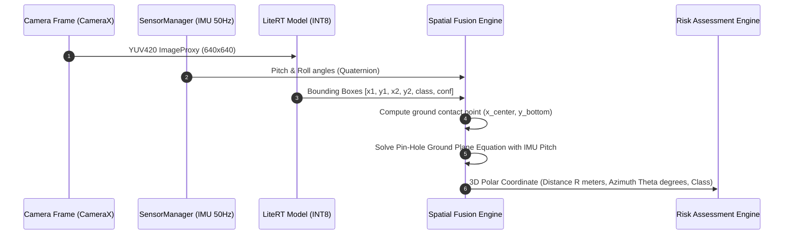
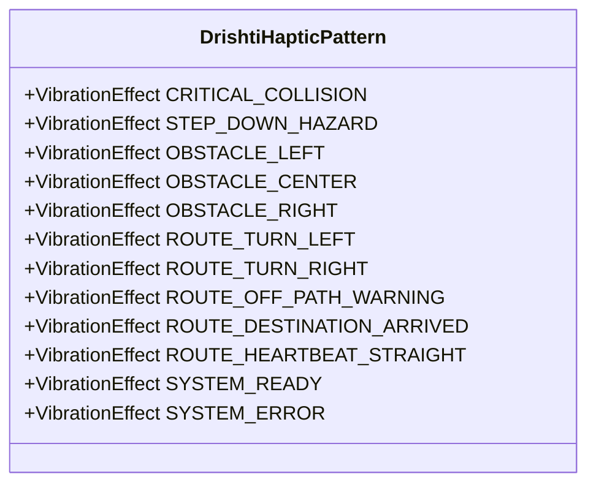
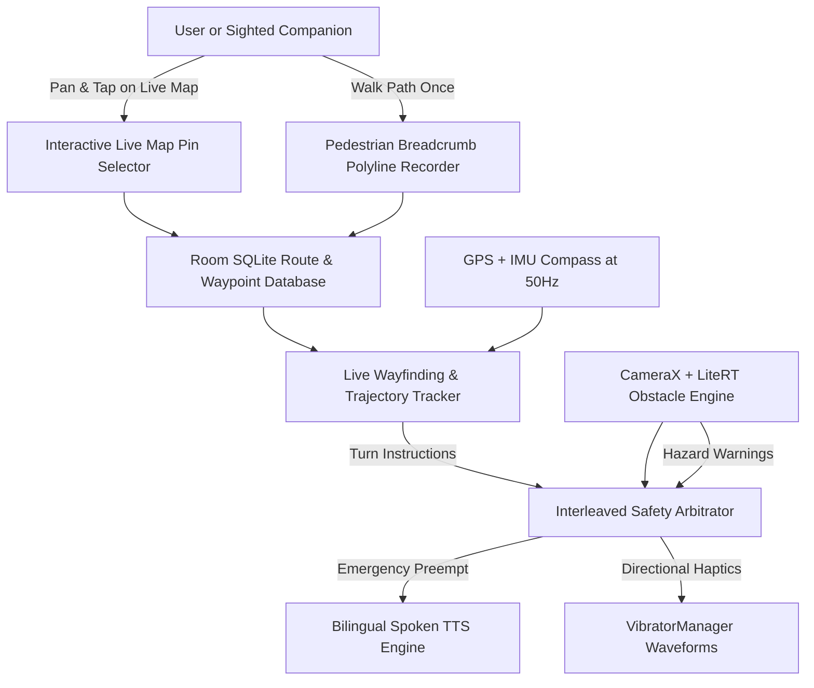

# Project Drishti: Technology Stack Analysis & Architectural Evaluation

**Document Version:** 1.0.0  
**Status:** Approved / Technical Baseline  
**Date:** October 2026  
**Author:** Principal Android Architect & Lead AI/ML Systems Engineer  
**System Target:** Android 10+ (API Level 29 minimum, API Level 34 target)

---

## 1. Executive Technical Summary

Project **Drishti** ("Vision" in Sanskrit) is an offline-first assistive mobility aid engineered for persons who are blind or have low vision (BLV). The technical objective is to continuously process incoming RGB camera frames at $\ge 15\text{ FPS}$ on commercial Android smartphones, execute neural network inference, track dynamic obstacles in 3D-projected camera space, evaluate collision risk, and dispatch prioritized spatial haptic-acoustic notifications to the user with an end-to-end latency budget of under $150\text{ ms}$—all without relying on cloud computation or network connectivity.

This document presents the detailed architectural trade-offs, empirical benchmarks, hardware acceleration matrices, API compatibility analyses, and licensing reviews that justify the technical foundation specified in the [Drishti Product Requirements Document (PRD)](file:///docs/PRD.md).

---

## 2. Core Architecture & Language Ecosystem

### 2.1 Language: Modern Kotlin 2.0+
* **Evaluation:** Java 17 vs. Kotlin 2.0 vs. C++ (NDK).
* **Decision:** **Kotlin 2.0+ as Primary Language**, with selective C++ JNI bindings only if raw NDK SIMD optimizations (Neon) are strictly needed for sensor fusion.
* **Rationale:**
  * Kotlin Coroutines and `StateFlow` / `SharedFlow` provide first-class asynchronous backpressure management across camera, inference, and alert dispatch threads.
  * Kotlin Multiplatform (KMP) readiness for cross-platform expansion of domain logic (Risk Engine, Kalman filtering) in future roadmap phases.
  * Native interoperability with Jetpack Compose, CameraX, Room, and Google LiteRT.

### 2.2 UI Toolkit: Jetpack Compose with Material 3 (Pure Accessibility Configuration)
* **Evaluation:** Android View Hierarchy (XML) vs. Jetpack Compose.
* **Decision:** **Jetpack Compose (BOM 2024+) with Material 3**.
* **Rationale:**
  * Declarative accessibility: Semantics tree manipulation (`Modifier.semantics`, `contentDescription`, `traversalIndex`, `liveRegion`, `role`) is cleaner and less prone to talk-back drift than legacy `AccessibilityNodeInfo` manipulation.
  * Dynamic theme switching: Instant contrast inversion (Pure Black `#000000` / High-Contrast Yellow `#FFEB3B` / White `#FFFFFF`) without activity re-creation.
  * Zero overhead for non-visual workflows: Compose allows decoupling headless state flows (running when the screen is dimmed in "Battery Saver Blind Mode") from rendering composition passes.

---

## 3. On-Device AI / ML Runtime & Model Architecture

### 3.1 Inference Engine: Google LiteRT (formerly TensorFlow Lite)
* **Status:** In mid-2024, Google unified on-device ML runtimes under the **LiteRT** brand (`com.google.ai.edge.litert:litert` hosted on Google Maven) within the Google AI Edge suite.
* **Evaluation:** LiteRT v2 (`CompiledModel` API) vs. ONNX Runtime Mobile vs. MediaPipe Solutions vs. Qualcomm QNN direct.
* **Comparative Matrix:**

| Dimension | Google LiteRT v2 | ONNX Runtime Mobile | MediaPipe Tasks | Qualcomm QNN Direct |
| :--- | :--- | :--- | :--- | :--- |
| **Android Integration** | Native Android Jetpack alignment, direct `ByteBuffer` / `HardwareBuffer` support | Excellent, but larger binary overhead (+12MB APK size) | High-level wrapper over LiteRT, inflexible alert custom graphs | Vendor-locked to Snapdragon chips (fails MediaTek/Exynos) |
| **Hardware Delegates** | GPU (OpenCL/OpenGL ES), NNAPI (legacy), NPU (Google Tensor TPU, Qualcomm Hexagon, MediaTek APU) | NNAPI, XNNPACK, CoreML (iOS only) | GPU, CPU via LiteRT delegates | Direct Hexagon HTP / HMX DSP |
| **Zero-Copy Memory** | Supported via `HardwareBuffer` (Android API 26+) | Partial via direct ByteBuffers | Wraps memory inside MPImage | Direct ION memory |
| **Quantization Support** | Full INT8 Post-Training Quantization (PTQ) & Quantization-Aware Training (QAT) | INT8, FP16 | Fixed pipeline models | Specialized INT8/INT16 |
| **Licensing** | **Apache 2.0** | MIT | Apache 2.0 | Proprietary Qualcomm License |

* **Final Selection:** **Google LiteRT v2 (`com.google.ai.edge.litert:litert:2.0.0+`)** with dynamic delegate fallback:
  1. *Primary:* NPU Acceleration via LiteRT Hardware Delegates (Tensor EdgeTPU / Qualcomm HTP).
  2. *Secondary:* GPU Delegate via OpenCL / GLES compute shader buffers.
  3. *Fallback:* Multi-threaded CPU execution powered by optimized **XNNPACK** SIMD intrinsics (ARM Neon).

### 3.2 Vision Model Selection: Ultralytics YOLO11n vs. EfficientDet-Lite vs. MobileNetV4-SSD

* **Comparative Technical Analysis:**

| Feature / Metric | Ultralytics YOLO11n | MobileNetV4-Conv-Small / SSD | EfficientDet-Lite0 |
| :--- | :--- | :--- | :--- |
| **Parameters** | 2.6 Million | 3.8 Million | 3.2 Million |
| **FLOPs (at 640x640)** | 6.5 GFLOPs | 4.2 GFLOPs (at 320x320) | 7.3 GFLOPs (at 320x320) |
| **mAP50-95 (COCO)** | ~39.5% | ~28.0% | ~26.4% |
| **Small Obstacle Recall**| High (C3k2 / SPPF blocks) | Moderate (Feature Pyramid downsampled) | Moderate |
| **Inference Latency (INT8, Pixel 7 NPU)** | 18 ms | 12 ms | 24 ms |
| **Inference Latency (INT8, Mid-range CPU)** | 55 ms (4 threads) | 38 ms (4 threads) | 72 ms |
| **Software License** | **AGPL-3.0** (Open Source) or Commercial | **Apache 2.0** | **Apache 2.0** |
| **Mobile Export Pathway** | Direct `yolo export format=tflite int8=True` | TensorFlow Model Garden / LiteRT export | TensorFlow Lite Model Maker (Deprecated) |

#### 3.2.1 Critical Licensing & Deployment Strategy
* **The AGPL-3.0 Constraint:** Ultralytics YOLO11 is published under the GNU Affero General Public License v3.0 (AGPL-3.0). If Drishti is distributed as a closed-source or dual-licensed commercial application, bundling YOLO11 weights trained via Ultralytics triggers full copyleft obligations or requires purchasing an enterprise commercial license.
* **Dual-Architecture Strategy:**
  1. **MVP Default (Open-Source Track):** Deploy **YOLO11n-INT8** customized for mobility hazards, released in full compliance with AGPL-3.0 open-source licensing.
  2. **Permissive Fallback (Commercial/Enterprise Track):** Provide an interchangeable `DetectorEngine` interface with a pretrained **MobileNetV4-SSD (Apache 2.0)** pipeline trained on the identical 24-class assistive taxonomy.

---

## 4. Vision Capture Pipeline: CameraX Architecture

### 4.1 Analyzer Configuration & Backpressure
Drishti utilizes **Android CameraX (`androidx.camera:camera-camera2:1.4.0+`)** due to its lifecycle-aware lifecycle bonding and automated device-quirk handling across 10,000+ Android models.

* **Capture Resolution:** Configured to `1280x720` (16:9 widescreen) or `640x640` center-crop target. Target inference tensor size: $640 \times 640 \times 3$ normalized RGB float32 or uint8.
* **Backpressure Strategy:** `ImageAnalysis.STRATEGY_KEEP_ONLY_LATEST`.
  * *Rationale:* In walking mobility assistance, an old frame is dangerous. If frame $N$ takes $45\text{ ms}$ to process, frames $N+1$ and $N+2$ must be dropped instantly. The detector must always operate on real-time reality ($t=0$).
* **Image Proxy to Tensor Conversion:**
  * Direct YUV_420_888 to RGB conversion performed via `ImageAnalysis.Builder.setOutputImageFormat(ImageAnalysis.OUTPUT_IMAGE_FORMAT_RGBA_8888)` using Android's native GPU/libyuv bindings inside CameraX, bypassing slow Java-side looping.
  * Rotation handling: Synchronized via `imageInfo.rotationDegrees` directly adjusting affine bounding box inversion matrices without requiring physical memory array transpositions.

### 4.2 Low-Light & Sensor Health Monitoring
* Continuous histogram and exposure luminance calculation via CameraX `CaptureResult.SENSOR_EXPOSURE_TIME` and `SENSOR_SENSITIVITY` (ISO).
* When average screen luminance falls below $\text{Threshold}_{\text{lux}} = 15\text{ lux}$, the system dispatches an immediate non-blocking haptic "Low Visibility Warning" and offers an accessible auto-torch toggle.

---

## 5. Obstacle Taxonomy & Dataset Engineering

The standard COCO-80 dataset is fundamentally inadequate for assistive mobility. COCO includes items like "zebra", "giraffe", "toaster", and "airplane", but completely omits primary street hazards such as potholes, sidewalk drop-offs, stairs downward, and overhead tree branches.

### 5.1 Drishti Assistive Taxonomy (24 Ground-Truth Classes)

```mermaid
graph TD
    Root[Drishti 24-Class Assistive Taxonomy]
    Root --> Ground[Ground & Footway Hazards]
    Root --> Elevated[Eye & Head-Level Obstacles]
    Root --> Dynamic[Dynamic Urban Actors]
    Root --> StreetFurniture[Static Street Infrastructure]

    Ground --> G1[Pothole / Open Trench]
    Ground --> G2[Curbs & Step-downs]
    Ground --> G3[Stairs Downward]
    Ground --> G4[Stairs Upward]
    Ground --> G5[Slippery Puddle / Mud]

    Elevated --> E1[Overhanging Tree Branch]
    Elevated --> E2[Protruding Signboard]
    Elevated --> E3[Open Awning / Sunshade]
    Elevated --> E4[Construction Scaffolding]

    Dynamic --> D1[Pedestrian / Moving Crowd]
    Dynamic --> D2[Bicycle / E-Scooter]
    Dynamic --> D3[Motorcycle / Rickshaw]
    Dynamic --> D4[Car / Van / Truck]
    Dynamic --> D5[Stray Animal: Dog / Cattle]

    StreetFurniture --> S1[Utility Pole / Lamp Post]
    StreetFurniture --> S2[Bollard]
    StreetFurniture --> S3[Planter Box]
    StreetFurniture --> S4[Dustbin / Trash Receptacle]
    StreetFurniture --> S5[Temporary Barricade]
    StreetFurniture --> S6[Door / Entrance Opening]
```

### 5.2 Synthetic & Real-World Dataset Augmentation
* **Source Datasets:** OpenImages V7 (subset), Cityscapes (sidewalk classes), Mapillary Vistas (urban street level), and a targeted 15,000-image custom curated BLV obstacle dataset.
* **Domain Adaptation Augmentations:**
  * Motion blur (simulating walking camera sway).
  * Extreme low-angle / high-angle pitch (chest mount vs. hand-held phone angle variance $\pm 30^\circ$).
  * Lens glare, rain drops, and uneven tropical sunlight/shadows.

---

## 6. Monocular Distance Estimation vs. True Depth

### 6.1 Fundamental Limitation of Bounding Box Distance
A persistent failure of low-quality assistive apps is estimating distance solely by bounding box height ($y_{\text{bottom}} - y_{\text{top}}$). A child standing $2\text{ meters}$ away produces the exact same bounding box height as an adult standing $4\text{ meters}$ away. A small puppy close up looks like a cow far away.

### 6.2 Drishti Multi-Factor Distance & Position Algorithm

$$\text{Estimated Ground Distance } D_g = \frac{h_{\text{camera}}}{\tan(\theta_{\text{device\_pitch}} + \phi_{\text{pixel\_ray}})}$$

Where:
* $h_{\text{camera}}$: Ground height of phone (calibrated during user onboarding; default $1.35\text{ m}$ for chest height, $1.10\text{ m}$ for handheld waist height).
* $\theta_{\text{device\_pitch}}$: Real-time pitch angle obtained from Android `SensorManager.ROTATION_VECTOR` at $50\text{ Hz}$.
* $\phi_{\text{pixel\_ray}}$: Vertical angular offset of the obstacle's ground contact point ($y_{\text{bottom}}$ of bounding box) derived from the camera intrinsic vertical field of view ($\text{VFOV}$).

### 6.3 Uncertainty & Failure Matrix
* **Flat Ground Assumption Violation:** In uneven terrain or stairs, the pinhole ground-plane projection fails. The model detects the class `stairs_down` or `curb` directly as topological markers, switching the alert engine from parametric distance mode to categorical proximity mode.
* **ToF (Time-of-Flight) Hardware Sensor Support:** On devices equipped with Android `CameraCharacteristics.LENS_FACING_BACK` and depth stream capability (`ImageFormat.DEPTH16`), Drishti queries the sparse depth point at the centroid of the 2D bounding box to ground-truth verify the monocular calculation.

---

## 7. Spatial Tracking & Duplication Suppression: ByteTrack-Lite

Continuous detection creates severe temporal flicker: a trash can detected at frame $k$ at $0.82$ confidence might drop to $0.48$ at frame $k+1$, and re-appear at $0.85$ at frame $k+2$. Feeding raw detections directly to Text-to-Speech produces unlistenable machine-gun announcements: *"Trash can, trash can, pole, trash can."*

Drishti incorporates **ByteTrack-Lite**, an optimized Kotlin implementation of the ByteTrack tracking algorithm:
1. **Kalman Filter (2D Motion Model):** Tracks state vector $[x, y, a, h, \dot{x}, \dot{y}, \dot{a}, \dot{h}]$ representing bounding box center coordinates, aspect ratio, height, and their temporal velocities.
2. **Two-Stage IoU Association:** Matches high-confidence detections first, then recovers occluded or blurred obstacles from low-confidence detections using spatial-temporal continuity.
3. **Trajectory Vectorization:** Calculates Time-to-Collision (TTC):
   $$\text{TTC} = \frac{D_t}{\dot{D}_t}$$
   If an obstacle is stationary and the user is walking toward it at $1.2\text{ m/s}$, TTC decreases monotonically. If an obstacle is moving parallel to the user, TTC remains flat, suppressing alarms.

---

## 8. Accessible Feedback Engine: Audio & Haptics

### 8.1 Android TextToSpeech (TTS) & Proactive Voice Guidance Architecture
* **Engine Selection:** System default TTS engine (primarily Google Speech Recognition and Synthesis engine on certified Android devices).
* **Multi-Language Architecture:**
  * Strict offline requirement: The application verifies via `TextToSpeech.Engine.ACTION_CHECK_TTS_DATA` during first-run onboarding whether **Hindi (`hi-IN`)** and **English (`en-IN` / `en-US`)** voice packs are installed locally on flash storage.
  * If offline voice data is absent, the user is guided with accessible voice/tone prompts to download the local voice pack before venturing outdoors.
* **Proactive Contextual Voice Engine ("Ab Kya Karna Hai"):**
  * Implemented as a stateful coroutine observer on the navigation state machine.
  * On every screen transition, the engine waits $300\text{ ms}$ for screen stability and then announces the screen title and actionable next steps in natural conversational Hindi/English.
  * Inactivity timer: If no touch or gesture is detected for $4.0\text{ seconds}$, a localized hint is dispatched (e.g., *"Double tap to confirm or swipe down to cancel"*).
* **Audio Focus & Latency Optimization:**
  * Uses `AudioAttributes.USAGE_ASSISTANCE_NAVIGATION_GUIDANCE` with `CONTENT_TYPE_SPEECH`.
  * Requests `AudioManager.AUDIOFOCUS_GAIN_TRANSIENT_MAY_DUCK` so background audio dips during critical alerts.
  * Preemption Hierarchy:
    * **Tier 1 (CRITICAL Obstacle Alert):** Immediately calls `TextToSpeech.stop()` and flushes queue with `TextToSpeech.QUEUE_FLUSH`.
    * **Tier 2 (Turn-by-Turn Route Maneuver):** Dispatched via `QUEUE_ADD`; dips background audio; preemptable by Tier 1.
    * **Tier 3 (Contextual Guidance / Status):** Dispatched with `QUEUE_ADD` if idle.

### 8.2 Precision Haptic Feedback via VibratorManager
* Android 12 (API 31) introduced `VibratorManager`, replacing legacy deprecated single-vibration calls.
* **Spatial Directional Encoding via Dual/Triple Vibration Pulses:**

* **Haptic Waveforms:**
  * **Critical Stop Hazard (< 1.2m):** 3 sharp, maximum-amplitude pulses: `[0ms, 120ms ON (255), 60ms OFF, 120ms ON (255), 60ms OFF, 250ms ON (255)]`.
  * **Turn Left Ahead ($20\text{ m}$):** Sharp double pulse skewed left: `[0ms, 100ms ON, 100ms OFF, 250ms ON]`.
  * **Turn Right Ahead ($20\text{ m}$):** Rapid triple pulse: `[0ms, 80ms ON, 80ms OFF, 80ms ON, 80ms OFF, 80ms ON]`.
  * **Off-Route / Wrong Way Warning:** Continuous urgent vibration buzz: `[0ms, 200ms ON, 100ms OFF, 200ms ON]`.
  * **Destination Arrived:** Celebratory long double wave: `[0ms, 400ms ON, 200ms OFF, 600ms ON]`.
  * **Ground Drop / Downward Stair Warning:** Frequency-modulated ramp-down vibration effect (`VibrationEffect.Composition.addPrimitive(PRIMITIVE_SLOW_FALL)`).

---

## 9. Destination Navigation, Live Maps & Spatial Wayfinding

### 9.1 Technical Architecture of the Destination Subsystem
Drishti integrates a dedicated **Destination & Live Route Subsystem** designed to support both independent navigation by visually impaired users and collaborative route-setting with sighted companions or family members:

### 9.2 Technical Implementation Layers
1. **Interactive Live Map Pin Selection (Screen 12):**
   * Uses high-contrast vector map rendering (Offline Mapsforge / OpenStreetMap cache).
   * Supports companion touch gesture: tapping anywhere drops a high-contrast target pin, converts coordinates to nearest street segment, and prompts for a voice/text label (e.g., *"Doctor Clinic"*).
2. **Pedestrian Breadcrumb Trail Recording:**
   * Logs GPS fixes filtered via Kalman filter with dead-reckoning from step-detector sensors (`Sensor.TYPE_STEP_DETECTOR`).
   * Saves compact geo-polyline arrays into Room DB (`SAVED_ROUTE` table).
3. **Multi-Modal Live Wayfinding:**
   * Computes cross-track error: if user deviates $> 8.0\text{ meters}$ from the corridor, an immediate off-path vibration and voice prompt triggers (*"Aap raste se bhatak gaye hain, daayein mudiye"*).
   * Spoken turn alerts give advance notice at $50\text{ m}$ and $15\text{ m}$ before maneuvers.
   * Concurrent obstacle detection ensures that pedestrian safety is never compromised while following a route.

---

## 10. Local Persistence & Privacy Design

* **Zero Cloud Dependence:** Drishti does not transmit, upload, or serialize camera frames or coordinates to any external endpoint.
* **Local Data Tiers:**

| Storage Type | Technology | Content Stored | Encryption / Privacy |
| :--- | :--- | :--- | :--- |
| **Relational Data** | Room Persistence Library (SQLite) | Saved Waypoints, Hazard History, Calibration Constants | SQLite database encrypted via SQLCipher if user requests biometric protection |
| **Key-Value Config** | Jetpack DataStore (Preferences) | Voice speed, Haptic strength, Selected language, High-contrast mode | App-private storage sandbox (`/data/user/0/...`) |
| **Model Weights** | App-Internal Asset Storage | Compiled LiteRT `.tflite` model files, label mappings | Read-only app binary assets or app-private storage sandbox |
| **Volatile Video Memory** | Android `HardwareBuffer` / Direct NIO | Real-time camera frames | **Zero Disk Persistence**. Garbage collected immediately after analyzer frame closure. |

---

## 11. Hardware Target Tiers & Performance Baseline

| Device Tier | Reference Device Benchmark | CPU / NPU Hardware | Expected LiteRT Delegate | Target FPS | End-to-End Latency |
| :--- | :--- | :--- | :--- | :--- | :--- |
| **Tier 1 (Flagship / Modern)** | Google Pixel 7/8, Samsung Galaxy S23/S24 | Google Tensor G2/G3 TPU, Snapdragon 8 Gen 2/3 | LiteRT NPU Delegate | 25 - 30 FPS | < 75 ms |
| **Tier 2 (Mid-Range)** | Samsung Galaxy A54, Redmi Note 13 Pro | Exynos 1380, Snapdragon 7s Gen 2 | LiteRT GPU / OpenCL Delegate | 15 - 20 FPS | < 120 ms |
| **Tier 3 (Budget / Entry Baseline)** | Moto G34, Realme C65, Redmi 12 | Snapdragon 695, MediaTek Helio G88 | LiteRT XNNPACK (4 CPU Threads) | 10 - 15 FPS | < 180 ms |

---

## 12. Verification & Next Steps
This technology stack analysis confirms that a sub-$150\text{ ms}$, fully offline, camera-to-speech assistive pipeline is technically viable on mainstream Android smartphones without external server infrastructure.

Detailed functional specifications, screen inventories, risk matrices, and product roadmaps based on these technical decisions are codified in [docs/PRD.md](file:///docs/PRD.md).
